# Task Gantt

An interactive project-management Gantt for Obsidian. **One Markdown file = one task**; a configured folder is shown and edited as a "table + timeline" Gantt — drag bars to reschedule, link dependencies, set milestones, sort and filter, and move tasks between folders by dragging.

> Requires **Obsidian 1.11.4 or later**.

## Screenshots

Open a folder as a Gantt from the left-column ribbon button, or by right-clicking the folder → **Open as Gantt**:

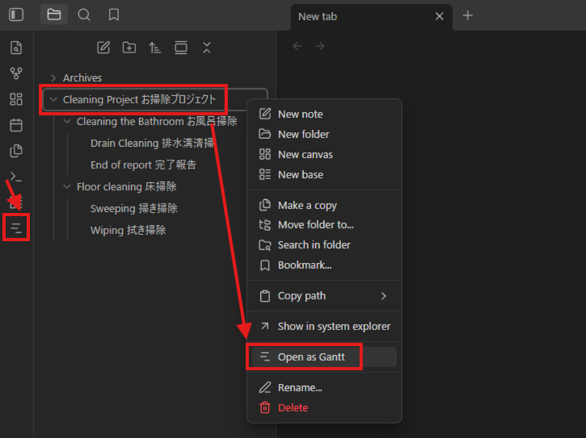

The folder opens as a table + timeline, with groups, bars, milestones, and dependency arrows:

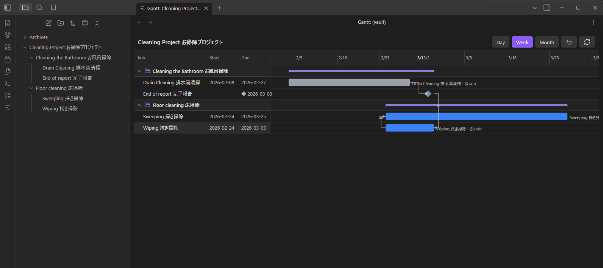

Click a task or its bar to open the detail panel beside the board and edit its dates, status, assignee, progress, and body:

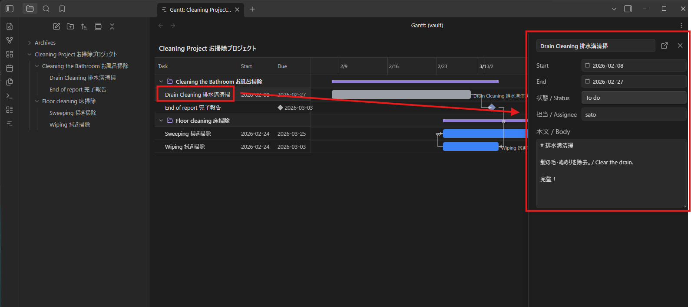

## Usage

1. In **Settings → Task Gantt**, set the **target folder** (e.g. `Projects/Cleanup`).
2. Open the view from the **"Open Gantt" ribbon icon** in the left column (or the command **"Open Gantt"**). The ribbon opens the Gantt for the folder of the currently open note — or the folder selected in the file explorer — and falls back to the default folder in settings (the **vault root** when none is set). You can also right-click any folder → **Open as Gantt**.
3. Direct subfolders become **groups**, and the `.md` files inside them become **tasks**.
4. **Drag a bar / resize its edges** to write the new dates back to that file's `start`/`end` frontmatter. **Every column the table can show is editable in place — just double-click the cell** (a single click selects the row, and a pencil marks editable cells on hover). Start and Due open a calendar, Duration takes a number of workdays (a unit may follow: `4d`, `4 days`, `4 ימים`), Progress takes a percentage (0–100; blank or 0 clears it), Status opens a dropdown, and Assignee and Tags open a small editor with a chip per value (× to remove) and an add field — assignees suggest the names already used on the board (type `[[` to link a note instead), tags suggest the vault's existing tags. Enter or clicking away saves, Esc cancels.
5. Click a task in the table or its bar to open the **detail panel** (dates, status, assignee, dependencies, progress, body). It sits beside the board instead of covering it: the timeline keeps its scale and the opened task's bar, outlined with a glow, stays where it was, moving only as far as needed when the panel would cover it, and you can scroll on as usual. It follows changes made elsewhere and closes with its × or **Esc**. Hover a bar for a summary card (dates, duration, status, progress, assignees). Links in the body are clickable (internal links open the note, Ctrl/Cmd-click for a new tab, with Page preview on hover); click anywhere else in the body to edit it, and type `[[` to insert a link to a note.
6. Use the **＋ New task** button to create a one-day task in the current folder and name it on the spot — its **▾** creates a [Kanban board or a Canvas](#task-kinds-note-kanban-canvas) task instead — and **Today** to scroll the timeline to the current date.
7. Use the **Day / Week / Month / Fit** buttons to change the timeline scale; the date in the middle of the screen stays put. **Fit** auto-scales to the pane width and re-fits when you resize (not when the detail panel opens or closes). In Day, Week and Month the timeline is endless: scroll past either end and more weeks, months or years are added (up to a year, three years or ten years on each side; changing the scale trims them again), and **Today** brings today into view wherever it is, a quarter of the way in, so most of the view shows what comes next. Today is a line with a *Today* pill above it; during a sprint (see below) its dates are washed in the accent colour, with a line under the dates naming it on hover. Hovering a row highlights it across the timeline, so a name and its bar line up. Under a right-to-left interface (Hebrew, Arabic) the board keeps this left-to-right layout, while names and tags in Hebrew, Arabic or any other script read in their own direction. Axis dates follow Obsidian's language: the month (the year in Month view) is named above them, each week below by its first day's number on an even weekly rhythm (*22 · 29 · 6 · 13*; the month band shows where a month turns), and non-working days are shaded. The folder name at the top left switches the board to another folder.
8. **Keyboard**: in the table, ↑/↓ (and Home/End, Page Up/Down) move between rows, →/← expand and collapse, **Enter** opens the detail panel (or toggles a group; while the panel is open the table narrows to the task names, so the timeline stays in view), **F2** renames, and **Shift+F10** or the menu key opens the row menu. **Esc** closes the panel and puts you back on the row.

The interface is in English. Hebrew notes, names, tags and Kanban steps are fully supported and read right to left.

## View options

The **Display** menu at the right end of the toolbar shapes how the board is displayed, so the toolbar stays one row. A thin legend under the toolbar explains the colors; it hides while the table already shows that column (Status when coloring by status, Assignee when coloring by assignee), since the column spells the colors out. Statuses can still be edited in settings.

At its top, **Group by** folder, status, assignee or tag, and **Color by** status or assignee; below them, what you switch less often, in three sections: **Timeline** (**Dependency arrows**, **Tags on bars**, **Progress line**), **Rows** (**Flat**, **Roll up**, **Show empty folders**) and which table **Columns** to show. Each board remembers all of this, plus which groups are collapsed. Rarer actions, **Export as PNG** and **Reload**, are in the view's **⋯** menu and the command palette. Status never relies on color alone: a bar is hollow while waiting to start, solid once started, hatched when deferred, faded once done, and fainter still when cancelled. **Overdue** tasks (due before today and neither completed nor cancelled) get a red outline and a red line from their due date to today. Nothing after a bar repeats what is already on screen: the name is in the table, the assignees follow the bar only while the Assignee column is hidden, the tags only while the Tags column is, and urgency is the **Urgent** tag on the row's name. Each group heading counts its open and overdue tasks (*5 open · 2 overdue*); grouped by assignee, that is each person's workload. The today line is a solid line in the accent color.

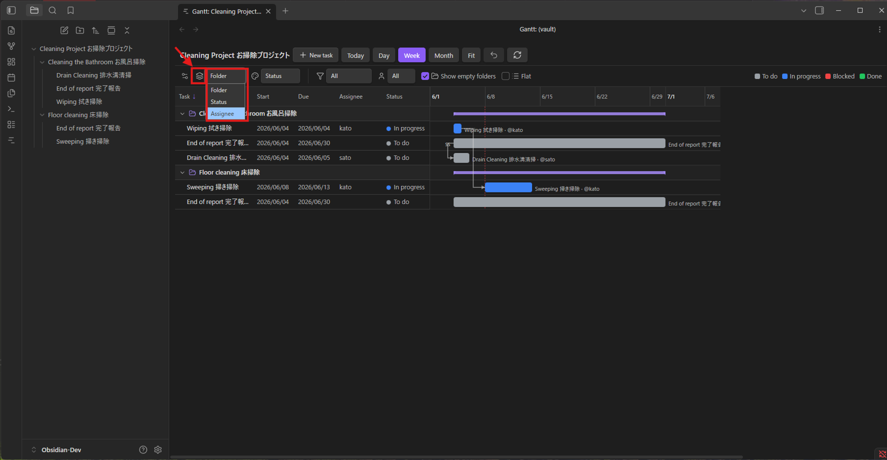

Each group heading has an icon for its grouping — a folder, a person, a status dot or a tag. **Right-click a heading** to pick its color and to give it any icon from Obsidian's icon set (searchable), e.g. a person icon for a folder that holds one person's work. In the legend, **click a status** to rename it, recolor it, change its group or delete it, and **＋** adds a status; when coloring by assignee, click a person to pick their color.

**Sort** by clicking a column header; click it again to flip ascending/descending (↑/↓):

**Reorder rows by hand**: drag a task row onto the top or bottom edge of another row (a line shows where it goes; the middle of a row still makes it a subtask), press **Alt+↑ / Alt+↓** on a row, or use **Move up / Move down** in the row's right-click menu. Rows move among their siblings (inside their folder or parent). The board then sorts **manually**, remembering the order per board; clicking a column header sorts by that column again, and the next move returns to your manual order.

**Disable a task** from the row's right-click menu (also Shift+F10 or a long press): it stays on the board, greyed out and listed last within its group, and can still be edited; **Enable task** brings it back, and both can be undone. The flag is kept per board in the plugin's settings, not in the note. Automatic status leaves disabled tasks alone, dependency changes don't push them (nor pass the push on through them), and they get no overdue or broken-dependency outline and aren't counted in the heading.

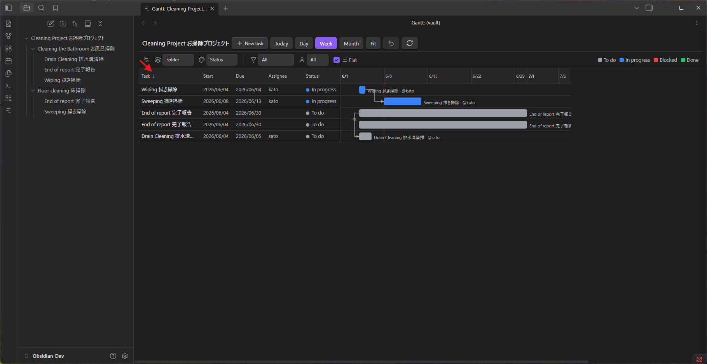

**Choose columns** in the **Display** menu — show or hide Start, Due, Duration, Progress, Assignee, Status, and Tags, and **reorder them** with the ↑/↓ arrows next to each (keyboard too; the task name always stays first). Hidden columns stay in the list, greyed out below the shown ones, so they can be re-shown or reordered at any time; their width and settings are kept. **Settings → Task Gantt → Table columns** offers the same list, plus each column's width. Any column shown here can be edited by double-clicking its cell. The column layout and sort are remembered across sessions:

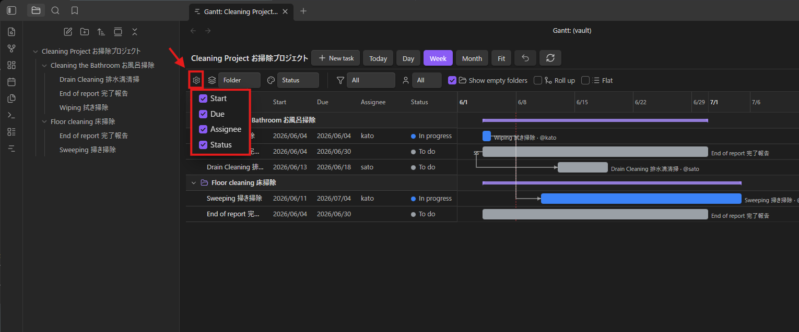

**Flat view** lists every task in one sorted list, ignoring folders and nesting:

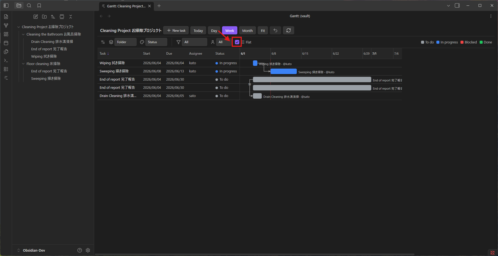

**Progress line** draws a jagged line down the board from today, bending to each task's achieved progress: **left of today means behind schedule, right means ahead**. Per row, the line sits at the point on the bar matching the task's `progress` — so a task due last week but only 40% done pulls the line back to its 40% mark. Tasks at 100% and tasks that haven't started yet (and aren't due to) stay on the today line, as do folder rows and rolled-up parent bars. A task past its start date with no progress pulls the line back to its start date. Its color is configurable in **Settings → Task Gantt → Progress line color**.

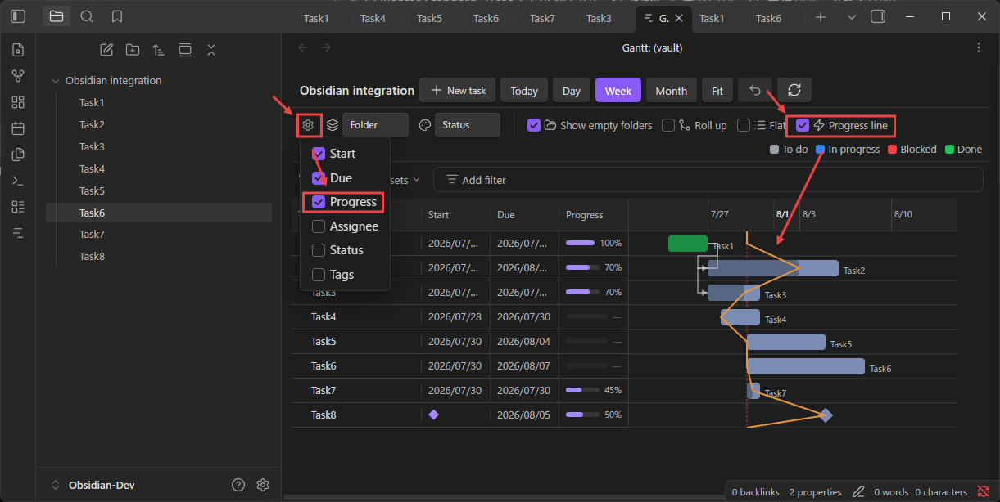

## Custom fields

Show any frontmatter key as a table column. In **Settings → Task Gantt → Custom fields**, click **Add field** and give it a **key** (the frontmatter property, e.g. `client`), an optional **label** for the column header, and a **type**:

- **Text** — shown as is. A list value is shown comma-separated, and editing it writes a list back.
- **Number** — right-aligned and sorted numerically.
- **Date** — shown in your date format and edited with the same calendar as Start / Due (the date part only).

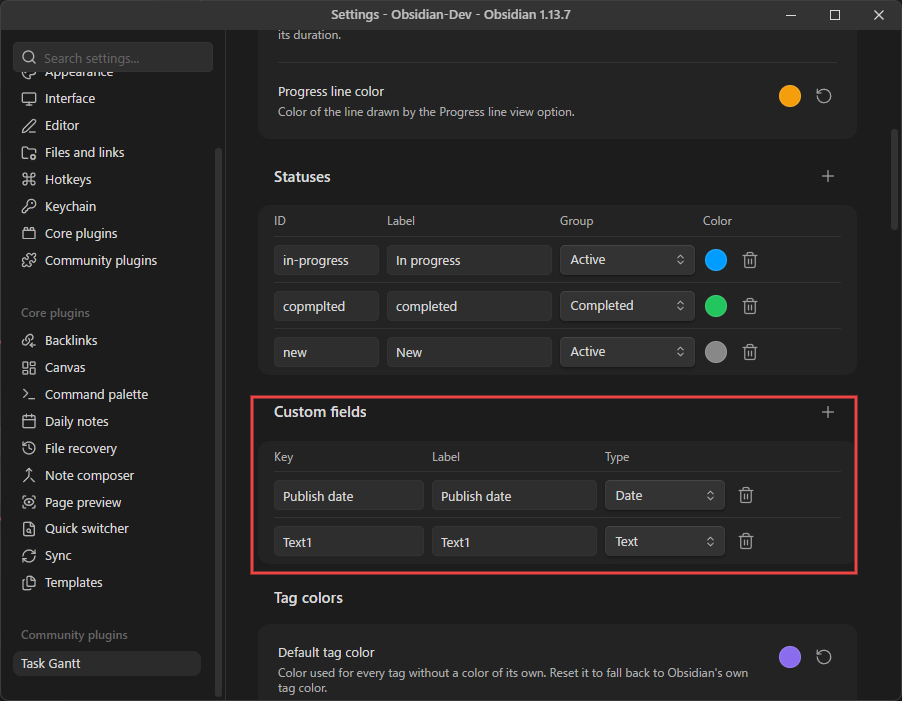

A new field's column is shown right away; hide or show it from the **Display** menu like any other column. Custom columns sort by clicking their header and are edited by double-clicking a cell, and every edit can be undone. Changing a field's key keeps its column's visibility, width and sort, and takes effect when you press Enter or leave the box. If notes still hold values under the old key, you're asked whether to rename that property in those notes too (a note that already has a value under the new key is never overwritten) or only to point the column at the new key. Keys the plugin already reads (the Start / Due / Status / … keys under **Frontmatter keys**, and `tags`) can't be used, and if two fields share a key only the first becomes a column — the settings tab says so.

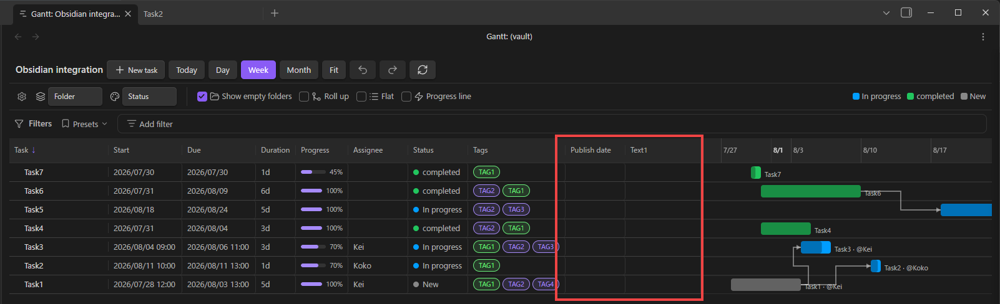

## Filters

A **filter row** below the options narrows the board. Click **Add filter** and pick a field — **Name**, **Status**, **Status group**, **Assignee**, **Tag**, **Start date**, or **Due date** — then set its condition. Each filter shows as a chip you can click to edit or remove with **×**.

- **Name** matches with *is / is not / contains / does not contain / starts with / ends with*.
- **Status / Status group / Assignee / Tag** let you tick several values — including **(none)** for unset — with *is / is not / is empty / is not empty*.
- **Start date / Due date** compare against a preset (yesterday/today/tomorrow), a specific date, a relative date (e.g. *1 week from now*, recomputed each day), or a date range, with *is / before / after / on or before / on or after / empty / not empty*.

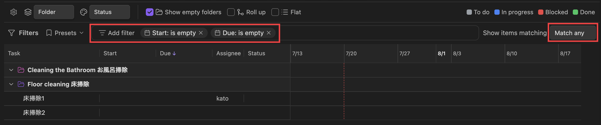

With two or more filters, choose **Show items matching → Match all** (AND) or **Match any** (OR) on the right.

### Presets

Open **Presets** for one-click filter sets. Start points by role switch the grouping as well: **Overview** keeps all outstanding work, grouped by project folder, undated and future work included (for a section head); **Upcoming 2 weeks** keeps work starting after today and within two weeks; **Attention** keeps what is blocked (Deferred group), overdue or urgent; **My work** keeps your own outstanding tasks, and appears once you set **Settings → Task Gantt → Your name on this device** (stored on the device only, so each person in a shared vault sets their own). The filter chips always spell out the scope, and an empty board says whether the filters hide everything (with **Clear filters**) or the folder is empty. Presets are views over the same notes, not permissions. View settings (grouping, filters, columns, expanded rows) live in this device's plugin settings and aren't shared; editing a task changes its note. The board stays readable without any preset. The other built-in presets are **No dates (no bar)**, **Unassigned** and **Completed**; *Completed* reads the **status group** rather than status names, so it is everything in the Completed group. (*Overview* already keeps everything neither Completed nor Cancelled, and *Attention* holds what is overdue.) Build any combination of filters and **save it as a preset** by typing a name — saved presets can be re-applied or deleted, and **Clear filters** removes them all. Filters and presets persist across sessions: each tab keeps its own filters, so trying one in a tab never changes another (the [People layout](#timeline-board-and-people) replaces the earlier *Team* preset).

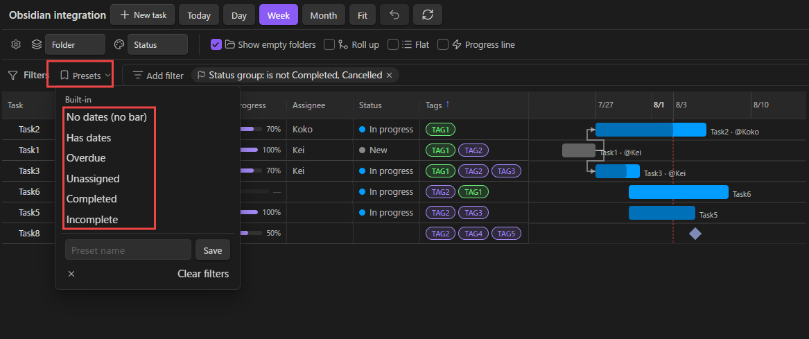

## At a glance

The table is the main reading surface. A new board shows **Assignee, Status and Due** next to a wider task name, leaving the timeline room (a Kanban task's checked count rides in its board cue; existing setups keep their columns, and Progress is one click away in Display). Each row carries **one attention tag** at most: the strongest of **Urgent**, **Overdue** (due before today and not finished), **Blocked** (a Deferred-group status), **Date clash** (a predecessor's dates break the link, arrows shown or not), **Interrupted** and **Resume** (see below), as an icon and a word, with *+N* when there are more (*Overdue +1*). The detail panel lists every reason with what is known: the due date, the blocking status with a field saying what it is waiting for (see [Blocked work](#blocked-work-what-is-it-waiting-for)), the predecessor waited on, the urgent work and whose it is, and the reasons of its subtasks. A row whose Status column already says Blocked doesn't repeat it. The button at the start of the **Task** header folds every heading at once, one line per project for a quick overview, and unfolds them again; hovering a heading shows its whole line when the table is too narrow for it. Group headings say how far along they are and what needs attention: *1/8 · 1 blocked · 1 overdue* (*1/8* = done of all, cancelled left out; grouped by assignee, two or more tasks in progress at once are shown too). Hovering a heading shows the whole line, with what is open and in progress and what comes next: *1/8 · 7 open · 2 in progress · 1 blocked · 1 overdue · next: Data migration › Import into new DB 2026/11/09* (*in progress* is the started status; *next* is the earliest task starting after today, with its parent in front when it's a subtask, so it can be found inside a collapsed parent). Task names keep their full length: the exception tag, the board cue and the heading's *next* are cut first. Status marks differ by shape as well as colour: a ring for queued Active statuses, a filled dot for the started one, a square for Deferred, a check for Completed and a cross for Cancelled. Bars follow the same grammar: hollow while waiting to start, solid once started, hatched when deferred and faded once done, so finished work steps back. A task past its due date trails a red line to today, so late work shows even when the view is at today. The **Progress** column is empty when a task has no progress, and a Kanban task shows its checked cards, its steps (*4/7 steps*), which is not a measure of effort or schedule. On narrow panes a tag shrinks to its icon before a task name is cut, and its word stays in the tooltip.

## Timeline, Board and People

Each tab shows its board one of three ways, picked with **Timeline · Board · People** next to the board's name and remembered per tab: the **Timeline** (the table and the Gantt, for planning), the **Board** (one column per status, for the daily scrum) and **People** (one card per person). Several boards can be open at once: the ribbon, the **Open Gantt** command and a folder's **Open as Gantt** open a new tab for a folder (or bring forward the tab already showing it), and the board name at the top still switches a tab to another folder. Each tab keeps its own filters; tabs of the same folder share that board's grouping, collapsed rows and disabled tasks. Switching a tab back to the Timeline shows today.

**The current window.** During a sprint (below) everything folds to that sprint; without one, to two weeks either side of today. The Board's **Done** shows what was finished since the window began and its open columns fold what starts after it ends (*Show N older* / *Show N later*); the Timeline folds finished work from before the window too, behind a **Show N older** chip in the filter row, so it doesn't keep growing while the history stays one click away (the notes are never touched). A finished task counts from the day it was finished (else its due date), so every computer folds the same way.

**Board**: the work by status, laid out to walk at the daily scrum from right to left. Columns follow the order of your statuses, each counting the cards it shows; Cancelled ones aren't shown. A status this computer doesn't know (one someone else added in their own settings) gets a dashed column of its own, and cards without a status get **No status**; neither takes drops, so a drop never clears or invents a status. In each column, work needing attention comes first (urgent, overdue, broken dependency, interrupted), then the table's sort. Columns share the width equally, and nothing on a card is cut short: a long name or step wraps onto more lines. A card shows the project (only when the board spans several folders) and the parent of a subtask (click it to open the parent); the name, with its people at the end of its line; then up to two warnings (*Overdue · Blocked*), a Kanban task's steps (*5/7 · next step*) and done subtasks (*1/2*). A parent whose subtasks are on the board isn't a card of its own, so nothing is counted twice. **Drag a card onto another column** to change its status (undoable; cards in a room you may only read show a lock and don't move). A card dropped on a Deferred column (Blocked) opens its details with the cursor in **What is it waiting for?**, and the answer shows on the card (see [Blocked work](#blocked-work-what-is-it-waiting-for)). Click a card (or Tab to it and press Enter) for the details panel, whose Status field changes the status without dragging; right-click or Shift+F10 opens the row menu.

**People**: one card per person, you first (once **Your name on this device** is set), then everyone by name, and **Unassigned** last while it holds open work. **Now** lists the work each person has started (any status but the not-started ones, Blocked included), up to three with *Show N more*; **Next** lists two other open tasks by due date; **Done since <day>** lists what they finished and the steps ticked on their tasks since the last daily scrum. Without filters, someone with nothing started still gets a card saying *Nothing in progress*. A shared task shows under each of its people, without repeating the card's own person.

**Which one is you?** The first time People opens on a computer without **Your name on this device**, a bar above the cards lists the people: one click sets it (your card comes first, work linked to yours is marked and **My work** appears), and its × closes the question for good. Change the name later in settings.

**Done since the last daily scrum**: the board says what got done, so nobody has to. *Since* is the last workday before today (Thursday, at a Sunday daily: the week runs Sunday to Thursday unless **Non-working days** in settings says otherwise). It counts two things:

- a **task moved into a Completed status**: the plugin writes `completed: <date>` into its frontmatter in the same write as the status, whether the status changes on the Board, in the table, in the details panel or by automatic status; moving between completed statuses keeps the date, leaving Completed clears it, and undo puts it back. A status typed by hand into the note gets no date, and a task done before this version has none, so neither counts as recent.
- a **step ticked**, wherever it is ticked: on the Kanban board, in the details panel or on another computer. Nothing is written into the card: each computer notes the day it first sees the tick while a board is open, so a tick made while it was off counts from the day it next sees it. A card that carries a date in the [Tasks](https://github.com/obsidian-tasks-group/obsidian-tasks) plugin's form (`✅ <date>`) counts from that date, and unticking it in the details panel removes the date.

On the Board, a Done card finished since then shows ✓ and its weekday (*✓ Sun*), and a card with steps ticked since then shows *✓ 2 steps* (the tooltip names them). People lists the same under **Done since <day>** (a step counts for everyone on its task, since a tick doesn't say who made it).

**Linked to your work**: once your device name is set, other people's open tasks linked to one of your open tasks by a dependency say which way, in words: *you wait on it* (your task depends on it) or *waits on you* (it depends on yours); the tooltip names your task.

**Sprints**: give a note the tag `#sprint` (or `#sprint/12`; the Hebrew `#ספרינט` works the same) and the sprint's dates, and put the goal in its name (*Sprint 12 — DB adapter in production*). It is a bar on the Timeline like any task, and while today falls inside it the Board and People show one line above the cards: its name, the workday and how much of the sprint's work is done (*day 5 of 10 · 1 of 9 done*), counted for the whole team as the Board shows it, whatever this tab's filters; click it to open the note. A small bar after it compares the two by length: its fill is the share of work done, its mark the share of days gone, so a fill well short of the mark means the sprint is behind. The Board becomes that sprint's board (see *The current window*). Sprint notes never get warnings, aren't cards and aren't counted in group headings.

**New task** makes a task in the first not-started status (To do); on the Board and People it is undated, so it doesn't show up as overdue the next day. When the board's folder is outside every [Vault Rooms](#shared-vaults-vault-rooms) room but holds rooms you can edit (say a *Team* folder whose projects are the rooms), it asks which room the task goes in, offering the board's own folder last as *not shared*: a task made outside the rooms would be shared with nobody. **Export as PNG** draws the Timeline.

Automatic status (in Settings) changes statuses by date in the shared notes, for everyone; a team that moves cards by hand at the daily scrum usually leaves it off.

## Blocked work: what is it waiting for?

A task in a Deferred status (Blocked by default) asks one question at the top of its details: **What is it waiting for?** Type the answer in a line (who or what, and since when: *Security approval of the new limits (asked Mon)*) and press Enter. It is written to the note's `blocker` frontmatter (undoable) and shows under the card's name on the Board and People, in the details and in the [status report](#status-report-for-your-manager). Dropping a card on a Deferred column, or picking a Deferred status in the details, puts the cursor in the field. Moving the task out of the Deferred group clears the reason in the same write, so it never outlives the block.

## Status report for your manager

**Status report…** (the view's **⋯** menu, or the command) builds a short report from the board, shows it beside the two fields exactly as it will read, and copies it as Markdown, to paste into a note, an e-mail or a chat. You add the two things only you know:

- **How is it going?** *On track* (we will meet the goal as planned), *At risk* (we can meet it if a risk is handled) or *Off track* (we will miss it unless something changes). The plugin never picks it for you; click a picked one again to leave it out.
- A **headline**: what your manager should know first, with any ask.

The rest comes from the whole board, whatever this tab's filters, and each task appears once:

- **Needs attention**: blocked, overdue and urgent work, strongest first, with its people and reason (*Blocked: security approval of the new limits*, *Overdue: due Mon 23 Nov*, *Urgent; Interrupts DB Adapter*). Date clashes and interruptions are yours to sort out, so they stay on the board.
- **Done since** the sprint began (without a sprint, two weeks ago), **Now** (started work, with a Kanban task's steps or the progress) and **Next** (work starting before the sprint ends, by start date): the People view's words.
- **Projects**: one line per project folder with done of all and the open counts of the Timeline's headings.

It is laid out to be read at a glance in Obsidian and still reads plainly in a message: the health opens it as a callout in its colour (green, amber or red, with the headline inside), what needs attention is a small table (task, who, why), each heading carries its count (*Needs attention (3)*), and the sprint and each project get a text progress bar (*▰▰▰▱▱▱▱▱▱▱ 3 of 13 done*). Empty sections are left out. During a sprint the report carries its line (*day 8 of 10 · 3 of 13 done*), so at the sprint review it doubles as the sprint report.

## Plan assistant (AI on your own server)

**Ask the plan assistant** (the command, or the view's **⋯** menu) opens a chat in the right sidebar about the board you used last. Ask it about projects, tasks, people and statuses (*What needs attention, and why?*, *Who is working on what?*), have it summarize (*Summarize this sprint for my manager*), or ask for a change (*Delay Data migration by three workdays*, *Mark API rate limits blocked: waiting for security*). It looks the board up as it answers, and never guesses. A change comes back as a **proposal card**: each task's change, before → after, and every task that depends on a moved one, rescheduled the way the board always does (finish-to-start successors pushed, start- and finish-linked ones realigned, lengths kept in workdays). Nothing is written until you press **Apply**, and Apply is one step: **Ctrl+Z** on the board puts every task back.

Set it up in **Settings → Task Gantt → AI assistant**:

- **Server URL**: an OpenAI-compatible server on your network, usually ending in `/v1`, such as Ollama (`http://ai-server:11434/v1`), vLLM, LM Studio or a llama.cpp server.
- **Model**: one that can call tools. *gpt-oss:20b* fits a single 16 GB GPU; *qwen3:14b* and *qwen3:8b* also call tools well. Llama 3.x models are weak at it.
- **API key**: only if the server asks for one. It is kept in this computer's secure storage (the OS keychain), not in the vault.
- **Check connection**: asks the server for its models (then offered as you type the model), tries a short chat with the tools, and tries the embeddings when set, with a ✓ or the server's own error for each.
- **Team instructions**: what the assistant can't see on the board, added after its built-in instructions: your terms (*Ops is the infrastructure team*), priorities, how to answer. Keep it short: it is sent with every question.
- **Advanced connection settings**, for servers set up differently:
  - **API**: *Chat Completions* (`/chat/completions`), which every OpenAI-compatible server offers, or the newer *Responses* API (`/responses`), which OpenAI, vLLM and recent llama.cpp servers also offer.
  - **Chat endpoint**: a path under the server URL, or a full URL (Ollama's own API: `/api/chat`).
  - **Embeddings model** and **endpoint** (`/embeddings`; Ollama's own: `/api/embed`): optional. With an embeddings model (*bge-m3*, *nomic-embed-text*), a search that matches no task's words finds the closest tasks by meaning, including across Hebrew and English (*העברת נתונים* finds *Data migration*).
  - **Extra request fields**: a JSON object added to every chat request, for options your server takes (`{"max_tokens": 2048}`); it can replace the default temperature of 0.2.
  - **Extra headers**: a JSON object of HTTP headers; `{key}` stands for the API key (`{"api-key": "{key}"}`), and without it the key goes as a bearer token.
  - **Time limit**: seconds to wait for each answer (180 by default).

The assistant also reads the shapes other servers answer in: Ollama's own API, the older single `function_call`, and Qwen-style `<tool_call>` text from a server that doesn't parse the model's tool calls.

**How it is guided.** You write no prompt. Behind each question work three short things:

- **Built-in instructions**, the same for every question, so a server reads them once and reuses that work: today and the next ten workdays as dates, the work week, the current sprint, who is asking, the board's people, projects and statuses; four rules (look things up and never invent; ask only when the answer would change what it does, such as which task, how far to move it, or what a blocked task waits for; changes are proposals; answer in the language you write in); and a few lines on each kind of request: summaries and reports, moving dates, changing status or people, workload, risks.
- **What the plugin reads in your request** and says outright, because a small model skips an "if" and can misread a word: a delay that names no amount, day or date (*ask how far*) and, in a Hebrew request, the board's status for its status word (*"כחסומה" is the status Blocked*) and today's weekday.
- **The lookups themselves**: each task comes back with its dates in words (*started 9 days ago (Sun); ends in 2 days (Thu)*; in Hebrew for a Hebrew question), so the model does no calendar sums, and a proposal that can't be right is refused with what to do instead (an unknown status lists the real ones; blocking a task without saying what it waits for tells it to ask you).

The guidance is always part of the instructions rather than fetched for each kind of request. Measured on a local model with 25 requests in English and Hebrew, fetching it on demand got no more of them right and took about a sixth longer per question, since a server has to read again whatever changes between questions.

Server notes: Ollama serves the network with `OLLAMA_HOST=0.0.0.0`, and its default context of 4,096 tokens is tight, so raise it with `OLLAMA_CONTEXT_LENGTH` (say 16384). vLLM needs `--enable-auto-tool-choice` and a `--tool-call-parser` for the model; llama.cpp's server needs `--jinja` (and `--embeddings` for embeddings).

**Network use**: the assistant talks only to the server set here, and only while you chat. It sends your questions and what it looks up: task names, dates, statuses, people, blocker reasons, and the start of a task's note when it reads one; with an embeddings model, also the board's task names, to compare their meaning. Nothing else leaves this computer, and with no server set it makes no network requests at all.

## A daily scrum and sprint routine

The views are laid out for a short routine; none of it is enforced.

- **Daily scrum (15 minutes)**: open the **Board**. Walk it right to left: what is **Done** since the last scrum (✓ and its weekday), what is **Blocked** and what it waits for, what is **In progress** (urgent and overdue cards first), and what comes next in **To do**. Talk about the work; anything longer is taken after the scrum. To go person by person instead, use **People**: each card is that person's *Done since*, *Now* and *Next*.
- **Each person** sets **Your name on this device** once (People asks the first time). Their card then comes first, **Presets → My work** shows their own open work, and other people's tasks linked to theirs say *waits on you* or *you wait on it*.
- **When work stops**, drag it to **Blocked** and answer *What is it waiting for?*; drag it back when it moves again.
- **Each sprint**: at planning, make the sprint note (tag `#sprint`, the sprint's dates, the goal in its name) and give the sprint's tasks dates inside it. The Board and People then show that sprint, and its bar shows whether the team is behind. At the review, **Status report…** gives your manager the done and not-done picture.
- **New tasks** start from the team's [template](#creating-tasks), so whoever picks one up knows the outcome and when it's done without asking. Work with several steps becomes a [Kanban task](#task-kinds-note-kanban-canvas), whose cards are its steps.

## Urgent work

Mark unplanned, interrupting work as urgent from the row's right-click menu (**Mark as urgent / Clear urgent**, undoable) or by writing `priority: urgent` in its frontmatter. Urgent work that isn't finished sorts first among its siblings, carries an **Urgent** tag (a ⚡ and the word) on its row and card, and is counted in its group heading. Group by assignee to see who is handling it.

**Mark as urgent** (in the row menu, or the **Priority** row of the detail panel) also records what it interrupts, from the urgent note only (`interrupts: ["[[DB Adapter]]"]`). Only work in the *started* status (In progress by default) of the same person counts as current work; To do, dates or an assignment alone never do. One such task is linked as is; with several, or a task shared with others, you pick the one it interrupts (or **Don't link**). The interrupted task, its status and its board stay exactly as they were, and nothing is inferred: urgent work without a link interrupts nobody. While the urgent work runs, the linked task shows **Interrupted** (*Interrupted by Hotfix login (Dana)*). Only once every urgent task linking it is done or cancelled does it show **Resume** and sort right after urgent work; **Resume DB Adapter** (in the panel and the row menu) removes the links (undoable) and takes you back, to its board for a Kanban task, to its details otherwise, without changing its status.

## Shared vaults (Vault Rooms)

With a [Vault Rooms](https://github.com/AiSuperBot/vault-rooms) build that offers `canWrite(path)` (added after 0.3.11), tasks in a room you can only read show a lock: their bars can't be dragged, the detail panel says why and its fields are disabled, and any change is refused with a notice instead of being written and put back by Vault Rooms. Automatic status skips them too. When your role changes, an open board follows without losing selection, scroll or expanded rows. Without Vault Rooms, or outside rooms, nothing changes. Task Gantt shows no sync or freshness status: Vault Rooms' own panel is the place for that.

## Moving tasks between folders

When grouped by folder, **drag a task row** onto a folder to move the task into it (or onto another task to drop it into that task's folder). While you drag, the row under the pointer says what the drop will do, e.g. *Move to “Marketing”* or *Make subtask of “API”*. Without dragging, **right-click a task's name** (long-press on touch, Shift+F10 from the keyboard) for **Make subtask of…**, **Detach from parent**, **Move to folder…** and **Delete**. Links are updated automatically, and the move is **undoable** with **Ctrl/Cmd+Z** or the undo button. Empty folders stay visible as rows so you always have a drop target; the **Show empty folders** toggle (on by default) controls this.

## Subtasks

Give a task a `parent` (a single wikilink to another task) and it nests under that parent in the table — under every grouping except Flat — joined by a thin guide line. **Parents start collapsed**: the chevron expands one inline (or →/← on the keyboard), the title still opens the detail panel, and the board remembers which parents you opened. A parent shows how many of its subtasks are done beside its name (*2/5*, cancelled left out), and while collapsed it also carries its subtasks' strongest exception, so an overdue step isn't hidden. A [Kanban task](#task-kinds-note-kanban-canvas)'s cards are a separate execution layer and never become Gantt rows (see below). When grouped by folder, **drag a task onto another task** to make it a subtask — it moves into the parent's folder with its whole subtree; **drag it onto a folder** to detach it back to the top level. Cycles are blocked, and every move is undoable. The **Roll up** toggle draws a parent's bar (and its Start/Due cells) as the span of its descendants. Set or clear the parent from the detail panel.

## Tags

Tasks use Obsidian's native `tags` (frontmatter `tags:` plus inline `#tag`), so they stay in sync with Obsidian's search and tag pane. **Group by Tag** to see a task under each of its tags — a multi-valued task appears in several groups — filter by tag, and show a **Tags** column of chips. When grouped by tag, **drag a task onto a tag group** to add that tag, distinct from a folder drop, which *moves* the task. Add or remove tags in the detail panel, or double-click the **Tags** cell to open the same editor there. Either way, tags are written to frontmatter `tags:` — a `#tag` written in the body is shown but can't be removed from here.

## Shared tasks (several assignees)

`assignee` can hold several people: write a list in the frontmatter, or add them one by one in the detail panel or the **Assignee** cell. A shared task shows a stacked avatar per person next to its bar (while the Assignee column is hidden) and a people icon by its name, and **color by assignee** splits its bar into one band per person (each person on the board gets a color of their own, and up to ten people never share one; click a person in the legend to pick another). **Group by assignee** lists the task under each of its people; the copies are joined by a dotted line, and hovering one highlights them all. A row doesn't repeat its heading's person: under *Ana*, the label and the **Assignee** cell show only the others, after a plus (*Visual design + Ben*), and a task Ana has alone shows just its name. Grouping by tag likewise leaves the heading's tag out of its rows. Drag a task onto a person's group to add them — the task keeps its other assignees. With one assignee the value stays a plain string, so existing notes keep their shape.

## Coloring tags and folders

Every tag starts from a single **Default tag color** — Obsidian's own tag color unless you change it in **Settings → Task Gantt → Tag colors** — and you can override any individual tag on top of that. Folders get an automatic color instead, one no other folder on the board has, so projects tell apart at a glance (the folder heading's icon on the Timeline, the dot before a card's project on the Board and People).

Colors are picked from a palette of 17, plus a rainbow swatch that opens your system's color picker for any hue. On the timeline, a task's tags follow its label as small pills tinted with each tag's color (up to three, then *+N*); turn them off with **Display → Tags on bars**.

**Right-click a folder heading, a tag heading, or a tag chip** to change or reset its color. Setting a color registers that tag under **Per-tag colors** in settings; resetting removes it again, so the list holds exactly the tags you have deliberately coloured — everything else follows the default. You can also add a tag there by picking it from your vault's tags, and removing one asks for confirmation, since the settings tab has no undo. Rows are listed alphabetically. Folder colors are right-click only.

<video src="https://github.com/katoiek/task-gantt/raw/main/docs/images/coloring_folder_tag.mp4" controls width="100%"></video>

> If the video doesn't play above, [watch it here](docs/images/coloring_folder_tag.mp4).

## Export as PNG

Choose **Export as PNG** from the view's **⋯** menu, or run the command, to save the whole board as an image, including rows scrolled out of view. It keeps the current theme and the **Display** menu's choices, adds the board's name and date on top and a color key for the current **Color by** underneath, and goes wherever your vault keeps attachments (a relative attachment setting is taken from the vault root, so nothing is added inside the board's folder). Each task is named once, in the image's left column (with a ✓ when it's completed, struck through when it's cancelled), so a bar is followed only by its people and tags; under a person's heading, only the other people on a shared task. A notice links to the file, or says why nothing was saved.

## Work plan for a quarter or a half (PPTX)

**Export work plan (PPTX)…** (the view's **⋯** menu, or the command) asks for a period (this or the next quarter, this or the next half) and saves the board's plan for it as a PowerPoint slide, in Hebrew and right to left, as a תוכנית עבודה (ת"ע) is drawn:

- **The calendar** runs from right to left under the title, the period and the board's name: the Hebrew months by their real dates, the Gregorian months under them, and a red line at today.
- **One row per person**, with a shared task in each of its people's rows. A task is a box over its days with its name inside, or beside it when the box is too small to show the name whole; a milestone is a diamond. A name reads in its own direction: English left to right, Hebrew right to left.
- **Colours** are the board's: a task takes the colour of its first [coloured tag](#coloring-tags-and-folders), or else its project folder's.
- **Markers** come from the task itself. The legend shows only the ones in use:
  - *בסיכון* (at risk): a red dashed outline on blocked or overdue work.
  - *שוטף* (routine work, tag `#שוטף` or `#routine`): a dark box.
  - *אי זמינות* (unavailable, such as leave or a course; tag `#אי-זמינות` or `#unavailable`): a grey box in italics.
  - *תלות בגורם חיצוני* (waits on an outside party, tag `#חיצוני` or `#external`): a chain-link icon in the box.
  - Done work is pale with a ✓, and an arrow marks work that runs past the period's edge.
  - Cancelled work and sprint notes are left out.

Too many rows for one slide go on over more slides, each with the title, legend and months. The file goes wherever your vault keeps attachments, named after the board and the period's first month (*Team 2026-10.pptx*), and a notice offers to open it. It is made on this computer; nothing is sent anywhere.

## Creating tasks

Press **＋ New task** to create a dated note in the current folder and rename it immediately. To start every new note task with the same headings, point **Settings → Task Gantt → Template for new tasks** at a note (keep it outside the boards' folders, or it shows up as a task); new note tasks start as a copy of it, frontmatter included, and the board then sets their status and dates. A template that lets someone pick a task up without asking can be as small as:

```markdown
### Outcome
%% What will be true when this is done, in a sentence or two %%

### Done when
- [ ] 

### Links
```

`%% … %%` is an Obsidian comment: it guides whoever writes the task and doesn't show in the details. A team-wide definition of done belongs in one note that the template links to. You don't have to start with **＋ New task**, though: every note inside the target folder already appears as a row — **including notes with no dates yet** — so you can also click an existing note and set **Start** / **Due** in the detail panel to turn it into a scheduled task. Empty cells are double-click editable too, so you can fill a blank value straight from the table.

## Task kinds: note, Kanban, Canvas

A task is always a note — its frontmatter keeps the dates, status and the rest — but its content can be one of three kinds. Pick one from the **▾** next to **＋ New task**:

- **Note** (the default): the body is the task's description.
- **Kanban board**: the note is created in the [Kanban plugin](https://github.com/mgmeyers/obsidian-kanban)'s format, with one lane per status, and the note itself is the board (its `kanban-plugin` frontmatter; a separate board file can't be linked). Its cards are the task's execution steps: they stay in the board and never become Gantt rows or subtasks. Its **progress is the share of checked cards**, counting every item in a lane as a card, as the board does; archived cards don't count, it only reads 100% when every card is checked, and it isn't edited by hand while the board has cards. In the table, one **board cue** follows the name, showing the board icon, the checked count (*4/7*) and the card, without the task's own name when the card starts with it (*DB Adapter — write the adapter* reads *write the adapter*) (its tooltip and label say *Current step* or *Next step*): the current card is the first unchecked card in the lane named like the started status (In progress by default, the lane a new board gets), the next card is the first unchecked card in board order, skipping lanes named like a completed, deferred or cancelled status (phase lanes are read in order), and without either it says *Steps*. Its tooltip adds *3 of 7 steps done* and the card's lane (a count of checked cards, not effort or schedule); clicking it opens the board in a new tab. The detail panel shows a short **Steps** summary instead of the board, after the fields (Settings → *Steps in the details panel* can put it right under the title): *3 of 7 steps done*, the current or next step, its lane, a collapsed **All 7 steps** list (every lane with its checked count, and the current or next card marked; the whole list reads in the board's own direction, so a Hebrew board reads right to left), and **Open Kanban**. **Click a card there to check or uncheck it**: the box is written to the board note, the progress and next card follow, and Ctrl+Z undoes it. Settings → *Kanban cards in the details panel* switches the list to **side-by-side lanes, like Kanban** (the earlier look; it scrolls sideways in a narrow panel, which is why the checklist is the default). Nothing is shown that the board doesn't say: card blockers and card dates aren't read. Boards are read only when they change. Card text is edited and cards are reordered on the board itself, drawn by the Kanban plugin; without it the note opens as Markdown, and a notice says to move list items to reorder cards.
- **Canvas**: a same-named `.canvas` is created next to the note, linked from its `canvas` key and embedded in the body, so the detail panel shows the canvas. Deleting the task deletes that canvas too, and undo brings both back.

The table marks Kanban and Canvas tasks with an icon. Any note counts as a Kanban task when its frontmatter has `kanban-plugin: board`, and as a Canvas task when its `canvas` key links to a `.canvas` file.

## Task frontmatter

Each task is a single Markdown file. The schedule lives in frontmatter; the description is the body.

```markdown
---
start: 2026-02-04
end: 2026-02-07
status: in-progress
assignee: kato
progress: 40
after:
  - "[[Sweeping]]"     # predecessor (dependency arrow)
---

# Wiping
The body is the task description (shown in the detail panel).
```

| Frontmatter | Meaning |
|-------------|---------|
| `start` / `end` | Start / end date `YYYY-MM-DD` (bar position and length). A time of day can be added as `YYYY-MM-DDTHH:mm+09:00` (edit via the detail panel; the offset follows the **Timezone** setting). |
| `status` | Status ID (defined in settings, reflected in bar color; its status group drives the Completed / Incomplete filters). |
| `assignee` | Assignee (in the Assignee column, or as avatars and names next to the bar while that column is hidden) — one value, or a list for a [shared task](#shared-tasks-several-assignees). Each can be a note link such as `"[[John Doe]]"` — it's shown as a clickable link, and the note's name is used for the label, legend, filters and grouping. |
| `progress` | Progress 0–100 (fill inside the bar; editable with the detail-panel slider, or by double-clicking the **Progress** column). |
| `after` | Array of wikilinks to predecessors (dependency arrows; violations turn red). |
| `milestone` | `true` for a diamond (zero duration). |
| `priority` | `urgent` (or `expedite`, `דחוף`, any case) marks [urgent interrupting work](#urgent-work). Other values (`high`, …) are normal work. |
| `interrupts` | On urgent work: links to the tasks it interrupted (written by **Mark as urgent**, removed by **Resume**; may be edited by hand). |
| `blocker` | What a task in a Deferred status (Blocked) is waiting for, in a line ([Blocked work](#blocked-work-what-is-it-waiting-for)). Cleared when the task leaves the Deferred group. |
| `gcal` | `true` opts the task into [Google Calendar sync](#google-calendar-sync-optional-desktop-only) (only used when **Sync flagged tasks only** is on). |
| `gcalId` | Set automatically once the task is pushed to Google Calendar — the linked event's ID. Don't edit by hand. |
| `canvas` | Link to a [Canvas task](#task-kinds-note-kanban-canvas)'s `.canvas` (set when the task is created). |

**Milestones:** a task that has only an `end` date (no `start`) is automatically treated as a milestone and drawn as a diamond. Setting `milestone: true` does the same. To turn a milestone back into a ranged task, give it a `start` date.

The task name is the file name (without extension); the group is the parent subfolder name. Frontmatter key names can be changed in settings.

Sample data for a quick try lives in `examples/Cleaning Project/` (point the target folder at it).

## Dependencies

Drag from a bar's round handle to another bar to create a dependency, or use **Add dependency…** in the detail panel: pick the type, then the task this one waits on. The connected ends decide the type: **FS** (finish→start), **SS** (start→start), **FF** (finish→finish). SS/FF successors snap to their predecessor when you reschedule. An FS successor is **pushed later when its predecessor slips into it** — it moves to the next workday after the predecessor's due date and keeps its duration — and the push carries on down the chain. Moving a predecessor earlier never pulls its successors back, so gaps you left on purpose stay. Turn this off with **Push FS successors automatically** in settings. Milestones never move through dependencies. A dependency that would close a loop (A waits on B, which waits on A) is refused; if notes already form one, nothing is pushed and a notice says why. To remove a dependency, hover its line and click the **×** that appears, or use the × on it in the detail panel; a notice offers **Undo** (so do **Ctrl/Cmd+Z** and the undo button). Clicking the line itself does nothing, so a stray click can't break a link. With **Display → Dependency arrows** off, a task whose dependency is broken still shows it with a dashed outline (red is kept for overdue).

## Duration

The **Duration** column (turn it on from the **Display** menu) shows how many **workdays** a task spans, counting both ends and skipping the non-working days set in settings (Friday and Saturday by default). It isn't stored anywhere: it's worked out from `start` and `end`, which stay the source of truth.

- **Change the duration** (double-click the cell, or use the field in the detail panel) and the start stays put while the due date moves. A task with no start date starts today.
- **Change only the start date** and the due date moves with it, so the duration stays the same — the bar slides. Changing the due date changes the duration instead. Dragging a bar's edge on the timeline resizes it as before.
- Together with FS dependencies you can schedule by duration: give each task a duration, chain them with FS links, and a slipping task pushes everything after it.

## Undo and redo

Every change made on the board can be undone with **Ctrl/Cmd+Z** or the undo button, and redone with **Ctrl/Cmd+Shift+Z**, **Ctrl/Cmd+Y** or the redo button: cell edits, everything in the detail panel (including renames and body text), dragging bars, dependencies, moves and subtasks, tags, and creating or deleting a task. Undoing a delete re-creates the note in place. Successors that moved along with a task move back with it. If a note has changed since (in another pane, or by sync), undo leaves it as it is and a notice offers **Undo anyway**. While you are typing in a text field, the shortcuts undo your typing instead. Renaming or moving the board's tasks or folders from the file explorer joins the history too, so undo always walks back in the order things happened. The history lasts while the board stays open on the same folder.

Changes made **outside Obsidian** — renaming, moving or deleting notes in Windows Explorer or macOS Finder, or by a sync tool — are not part of the history: Obsidian only sees them as a file disappearing and another appearing. Undoing an earlier change to such a note does nothing, so rename and move tasks inside Obsidian (the title field, or Obsidian's own file explorer) if you want to be able to undo it.

## Settings

Open **Settings → Task Gantt** to configure the default folder, subfolder recursion, the [template for new tasks](#creating-tasks), default zoom, and the **date display format**: by default a date reads at a glance, *Tue 24 Nov* (the month by name, so day and month can't be mixed up; the weekday for near-term planning; the year only outside the current one, *5 Jan 2027*), or numeric `YYYY/MM/DD`, `DD/MM/YYYY` or `MM/DD/YYYY`. Stored dates always stay ISO `YYYY-MM-DD`. A computer still on the old default, `YYYY/MM/DD`, moves to the glance format once; picking a format afterwards keeps it.

The **Timezone** setting (system or a fixed GMT offset, listed with representative cities) controls how times of day are displayed and saved, and which day counts as today (the today line, date filters, new tasks' dates). Changing it re-displays stored times in the new offset.

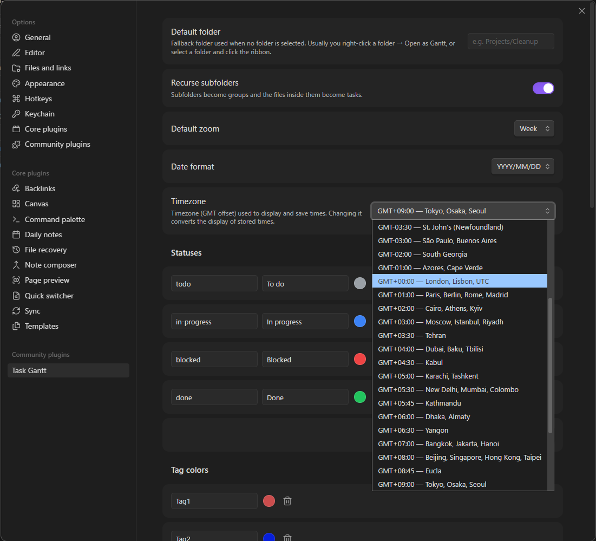

**Non-working days** (Friday & Saturday by default, a Sunday-to-Thursday week; or Saturday & Sunday, Sunday only, or none) are skipped when counting a task's duration and when dependencies move tasks, and are shaded on the timeline, whose Week scale marks each week's first workday. The setting is per computer, so set the same days on every computer of the team; a computer still on the old default, Saturday & Sunday, moves to Friday & Saturday once, and keeps Saturday & Sunday if it is picked again. **Push FS successors automatically** (on by default) controls whether a slipping predecessor pushes its FS successors.

**Automatic status** (off by default, found right after the general settings) sets each task's status from its dates, counting "today" in the **Timezone** above: before its start date it gets the first *not-started* status (default: the first Active status, e.g. To do); from its start through its due date (from its start on when it has no due date) the *started* status (default: In progress); after its due date the *finished* status (default: Done, else the first Completed status). When dates move, the status follows, back as well as forward. Pick the three under **Settings → Task Gantt → Automatic status**. A status already of the right kind is kept (another Active status while the task is running, any Completed status once it is past), and tasks in a Deferred or Cancelled status, tasks without dates and disabled tasks are never touched. A status you set by hand wins, and so does an **Undo**: that task is left alone until its dates change. Turning the setting on aligns every dated task once. It covers every task in the **default folder** and all its subfolders (the whole vault when none is set) in one run, started when a board opens, when the day changes while a board is open, and once after settings are saved. All the changes of one run are a single step in the undo history; a notice says how many tasks changed and offers **Undo**, which puts back only the status field (later edits to the notes stay, and a note whose status you changed since is left alone).

The **Progress line color** setting sets the color of the jagged line drawn by the **Progress line** view option, with a button to reset it to the default amber.

**Statuses are fully customizable** — add, edit, or delete them, here or straight from the legend on the board. Each status has an **id** (matches the `status` frontmatter value), a **label**, a **group**, and a **color** reflected in the bar.

The **group** is what tells the plugin whether a task is finished. There are four, borrowed from Wrike and not extensible: **Active** (being worked on), **Completed** (done), **Deferred** (paused — on hold, blocked, waiting), and **Cancelled** (dropped). Every status belongs to exactly one, and the *Completed* / *Incomplete* filter presets read only the group, never the status name — so a status called `Shipped` counts as finished as long as it sits in the Completed group. If no status is in the Completed group, settings say so and the *Completed* preset stays empty.

> Upgrading from 2.8.x: existing statuses are assigned a group once, guessed from their id and label, in English or Hebrew (`done`/`בוצע` → Completed, `cancelled`/`בוטל` → Cancelled, `on hold`/`blocked`/`חסום`/`בהמתנה` → Deferred, everything else → Active). Check the list after upgrading and correct anything the guess got wrong.

You can also rename the **frontmatter keys** the plugin reads (start, end, status, assignee, after, progress, milestone, canvas) to match your own vault conventions.

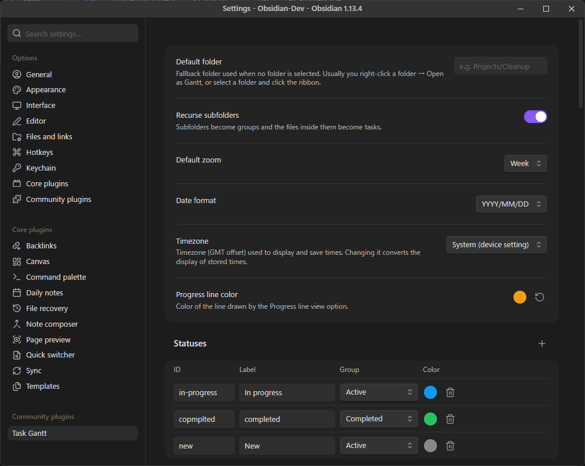

## Notifications (optional)

Task Gantt can post reminders for tasks that have a **time of day** to **Discord** and/or **Slack** via incoming webhooks. In **Settings → Task Gantt → Notifications**, set the webhook URLs, choose the targets (start / due), and pick the lead times (1 week / 1 day / 1 hour / 10 minutes before, or at the exact time). Use **Send a test message** to verify the webhook instantly.

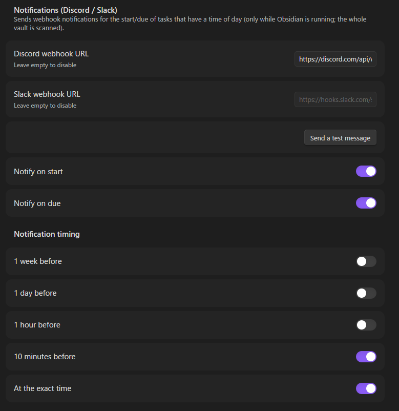

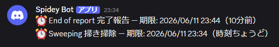

- **Network use**: when enabled, the plugin sends HTTP POST requests containing only the task name and its date/time to the webhook URLs you configured — nothing else is sent, and nowhere else. Leaving both URLs empty (the default) disables all network access.
- Notifications fire only while Obsidian is running. Triggers that passed while Obsidian was closed are skipped, and each trigger is sent at most once.
- Date-only tasks (without a time of day) are never notified.
- The whole vault is scanned — no folder configuration needed; any task with a time of day qualifies.

## Google Calendar sync (optional, desktop only)

Task Gantt can keep tasks and a Google calendar in **two-way sync**: task changes (create / reschedule / delete) are pushed as events, and moving or deleting those events in Google Calendar flows back into the task's frontmatter. Each direction can be toggled independently in **Settings → Task Gantt → Google Calendar**.

### Setup

The plugin has no server, so it uses **your own Google Cloud project**:

1. In [Google Cloud Console](https://console.cloud.google.com/), create a project and enable the **Google Calendar API**.
2. Configure the OAuth consent screen (External is fine) and add your own Google account as a **test user**. Because the app is yours and unverified, Google shows an "unverified app" warning during consent — expected, just continue.
3. Create an **OAuth client ID** of type **Desktop app**, and paste the client ID and secret into the plugin settings.
4. Press **Connect** — your browser opens Google's consent screen, and the plugin receives the authorization on `127.0.0.1` (loopback). Then pick the **calendar to sync** (a dedicated calendar is recommended).

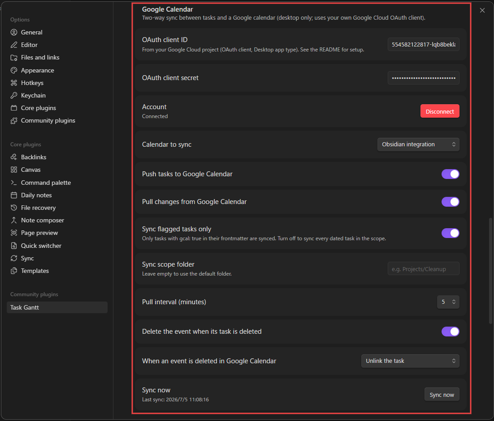

### How it syncs

- **Pull only ever touches events that Task Gantt itself created.** Creating an event directly in Google Calendar does **not** create a task, and editing or deleting a foreign (non-plugin) event is ignored — the plugin only reads back changes to events it pushed. Anything already on your calendar is left untouched.
- By default only tasks with the **`gcal: true`** flag in their frontmatter sync (**opt-in**; toggle it per task in the detail panel — which also shows an **Open in Google Calendar** link once synced). Turn off **Sync flagged tasks only** to sync every dated task in the scope folder instead.
- Date-only tasks become **all-day events**; tasks with a time of day on both ends become timed events (using the plugin's **Timezone** setting); milestones become one-day events. The linked event's ID is stored in the task's `gcalId` frontmatter key (set automatically — don't edit it by hand).
- Local edits push within seconds; remote changes are pulled at the configured interval (default 5 minutes). Titles sync one way only (task → event): renaming the event in Google Calendar is reverted on the next push, since renaming files from outside is risky.
- If both sides changed since the last sync, the **newer edit wins** and a notice tells you which side was kept.
- Deleting a task deletes its event (configurable). Deleting the event in Google Calendar just **unlinks** the task by default (optionally also clearing its dates) — files are never deleted.
- Recurring events are not supported (skipped by both directions).

**Example** — `Test1` and `Test2` carry `gcal: true` and pushed through as events; `Test3 (no flag)` stayed local only. The `Test3 from GC` event and a public holiday were created directly in Google Calendar and never became tasks:

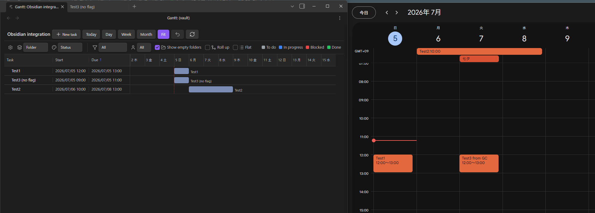

### Disclosure

- **Network use**: when connected, the plugin talks to Google's OAuth and Calendar APIs only, sending the synced tasks' name, dates, and a body excerpt (first 500 characters) with a link back to the note. Leaving the feature unconfigured (the default) makes no network requests.
- **Account & credentials**: requires a Google account and your own Google Cloud OAuth client. The plugin requests only the `calendar.events` and `calendar.calendarlist.readonly` scopes. The OAuth **client secret and refresh token are stored in Obsidian's secret storage** (the OS keychain), not in the plugin's `data.json`, so they don't travel with vault sync, backups, or git. Only the client ID stays in `data.json`. Secret storage is per device, so connect again on each device. Upgrading from 2.9.3 or earlier moves the old plain-text values out of `data.json` automatically; if that file was ever committed to git or shared, reset the client secret in Google Cloud Console and reconnect.
- Mobile is not supported (the OAuth loopback needs a desktop); other features work on mobile as usual.

## Vault access

To build the board, the plugin lists the Markdown files in your vault and reads their frontmatter through Obsidian's metadata cache. When the board is opened on a folder, only notes under that folder are shown, but notifications look at the whole vault, and renaming a custom field's key searches every note for that key. Nothing read this way leaves your device; the only network use is the optional notifications, Google Calendar sync and [plan assistant](#plan-assistant-ai-on-your-own-server) described above.

## Development

```bash
npm install      # install deps
npm run dev      # watch build
npm run build    # type-check + production build
npm test         # headless model tests
```

Copy `main.js` / `manifest.json` / `styles.css` into `<vault>/.obsidian/plugins/task-gantt/` to enable it.

## Design

See [`docs/adr/`](./docs/adr/) for the rationale behind design decisions (latest: ADR-0006) and [`CONTEXT.md`](./CONTEXT.md) for terminology.

## Limitations

Auto-scheduling (critical path), sub-day time granularity, and cross-folder aggregation are not implemented. Custom fields can't be used in filters yet.

## License

MIT — see [`LICENSE`](./LICENSE).
