# Task Gantt

**English** | [日本語](#日本語)

An interactive project-management Gantt for Obsidian. **One Markdown file = one task**; a configured folder is shown and edited as a "table + timeline" Gantt — drag bars to reschedule, link dependencies, set milestones, sort and filter, and move tasks between folders by dragging.

> Requires **Obsidian 1.11.4 or later**.

## Screenshots

Open a folder as a Gantt from the left-column ribbon button, or by right-clicking the folder → **Open as Gantt**:

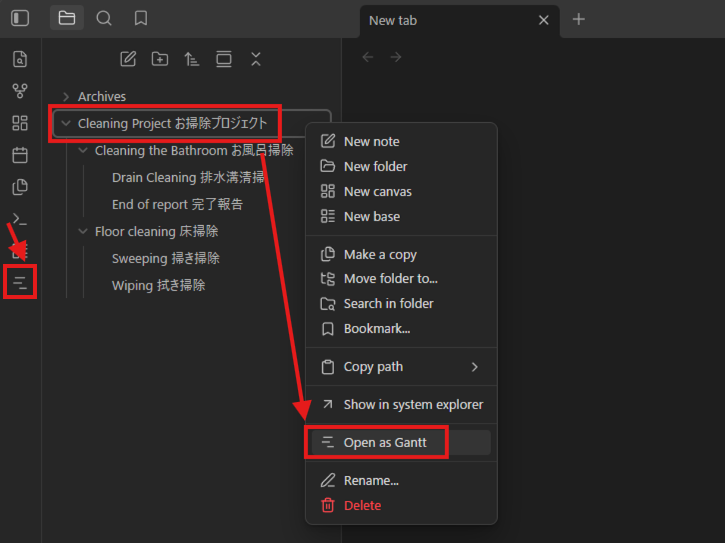

The folder opens as a table + timeline, with groups, bars, milestones, and dependency arrows:

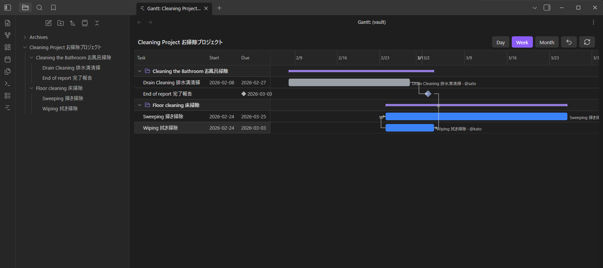

Click a task or its bar to open the detail panel beside the board and edit its dates, status, assignee, progress, and body:

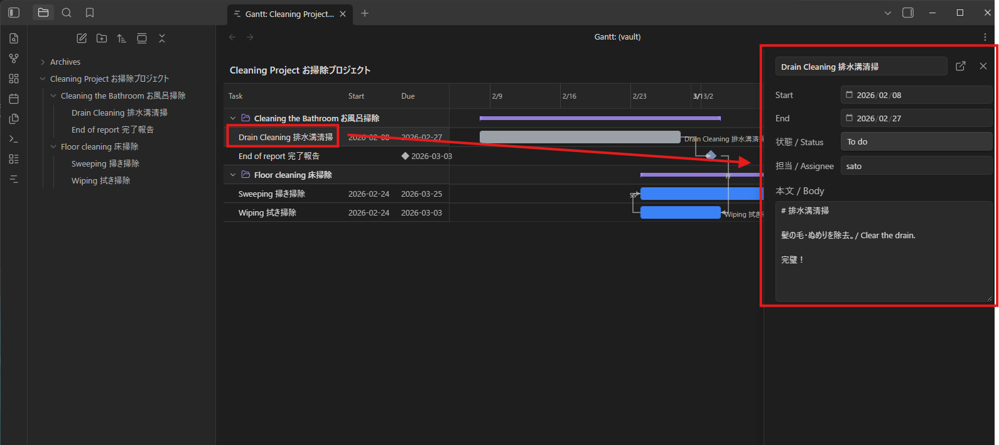

## Usage

1. In **Settings → Task Gantt**, set the **target folder** (e.g. `Projects/Cleanup`).
2. Open the view from the **"Open Gantt" ribbon icon** in the left column (or the command **"Open Gantt"**). The ribbon opens the Gantt for the folder of the currently open note — or the folder selected in the file explorer — and falls back to the default folder in settings (the **vault root** when none is set). You can also right-click any folder → **Open as Gantt**.
3. Direct subfolders become **groups**, and the `.md` files inside them become **tasks**.
4. **Drag a bar / resize its edges** to write the new dates back to that file's `start`/`end` frontmatter. **Every column the table can show is editable in place — just double-click the cell** (a single click selects the row, and a pencil marks editable cells on hover). Start and Due open a calendar, Duration takes a number of workdays, Progress takes a percentage (0–100; blank or 0 clears it), Status opens a dropdown, and Assignee and Tags open a small editor with a chip per value (× to remove) and an add field — assignees suggest the names already used on the board (type `[[` to link a note instead), tags suggest the vault's existing tags. Enter or clicking away saves, Esc cancels.
5. Click a task in the table or its bar to open the **detail panel** (dates, status, assignee, dependencies, progress, body). It sits beside the board instead of covering it, follows changes made elsewhere, and closes with its × or **Esc**. Hover a bar for a summary card (dates, duration, status, progress, assignees). Links in the body are clickable (internal links open the note, Ctrl/Cmd-click for a new tab, with Page preview on hover); click anywhere else in the body to edit it, and type `[[` to insert a link to a note.
6. Use the **＋ New task** button to create a one-day task in the current folder and name it on the spot — its **▾** creates a [Kanban board or a Canvas](#task-kinds-note-kanban-canvas) task instead — and **Today** to scroll the timeline to the current date.
7. Use the **Day / Week / Month / Fit** buttons to change the timeline scale; the date in the middle of the screen stays put. **Fit** auto-scales to the pane width and re-fits when you resize. Axis dates follow Obsidian's language, the month (the year in Month view) is named above them, and non-working days are shaded. The folder name at the top left switches the board to another folder.
8. **Keyboard**: in the table, ↑/↓ (and Home/End, Page Up/Down) move between rows, →/← expand and collapse, **Enter** opens the detail panel (or toggles a group), **F2** renames, and **Shift+F10** or the menu key opens the row menu. **Esc** closes the panel and puts you back on the row.

The UI follows Obsidian's display language. Supported: English, Japanese, Korean, Chinese (Simplified & Traditional), French, Spanish, and Russian; any other language falls back to English.

## View options

The right end of the toolbar shapes how the board is displayed: **Group by**, **Color by**, and the **Display** menu. A thin legend under the toolbar explains the colors.

**Group by** folder, status, assignee or tag, and **color by** status or assignee. **Display** holds what you switch less often, in three sections: **Timeline** (**Dependency arrows**, **Tags on bars**, **Progress line**), **Rows** (**Flat**, **Roll up**, **Show empty folders**) and which table **Columns** to show. Each board remembers all of this, plus which groups are collapsed. Rarer actions, **Export as PNG** and **Reload**, are in the view's **⋯** menu and the command palette. Status never relies on color alone: completed tasks get a ✓ on their label, deferred ones are hatched, and cancelled ones are faded and struck through.

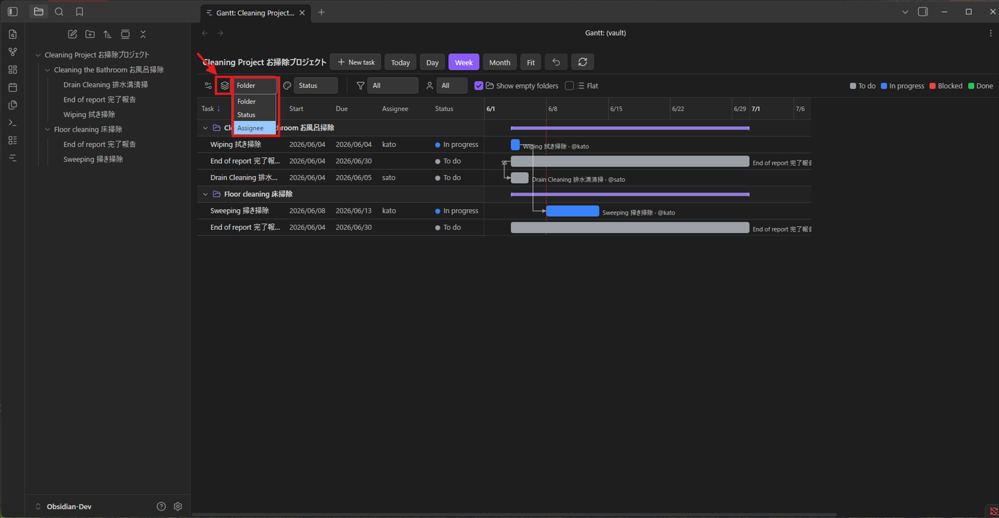

Each group heading has an icon for its grouping — a folder, a person, a status dot or a tag. **Right-click a heading** to pick its color and to give it any icon from Obsidian's icon set (searchable), e.g. a person icon for a folder that holds one person's work. In the legend, **click a status** to rename it, recolor it, change its group or delete it, and **＋** adds a status; when coloring by assignee, click a person to pick their color.

**Sort** by clicking a column header; click it again to flip ascending/descending (↑/↓):

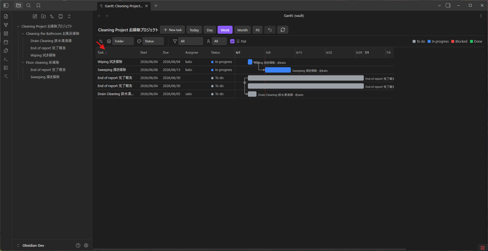

**Choose columns** in the **Display** menu — show or hide Start, Due, Duration, Progress, Assignee, Status, and Tags. Any column shown here can be edited by double-clicking its cell. The column layout and sort are remembered across sessions:

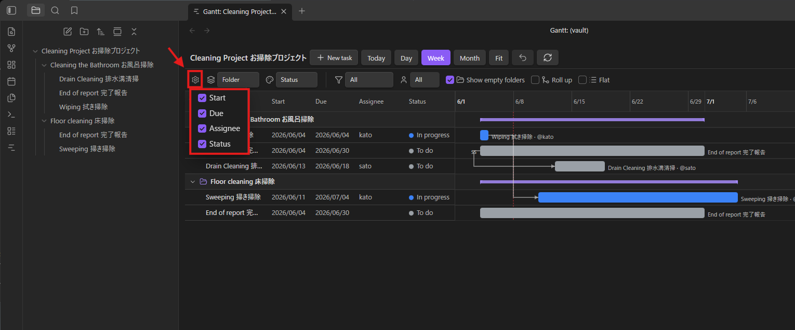

**Flat view** lists every task in one sorted list, ignoring folders and nesting:

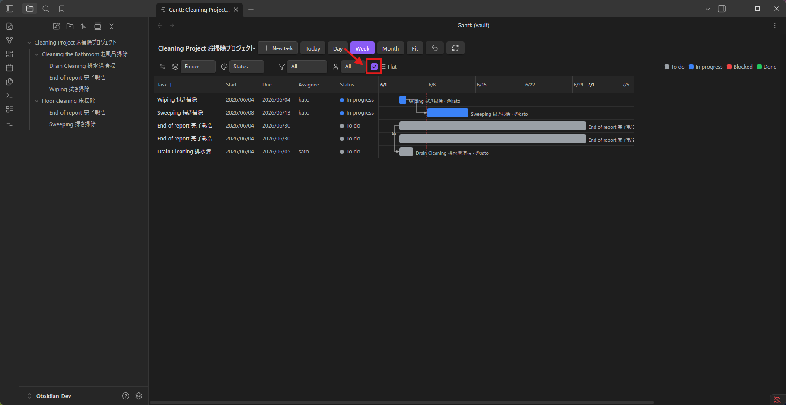

**Progress line** draws a jagged line down the board from today, bending to each task's achieved progress: **left of today means behind schedule, right means ahead**. Per row, the line sits at the point on the bar matching the task's `progress` — so a task due last week but only 40% done pulls the line back to its 40% mark. Tasks at 100% and tasks that haven't started yet (and aren't due to) stay on the today line, as do folder rows and rolled-up parent bars. A task past its start date with no progress pulls the line back to its start date. Its color is configurable in **Settings → Task Gantt → Progress line color**.

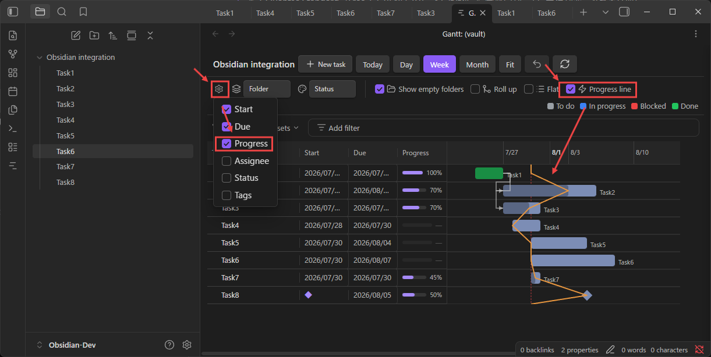

## Custom fields

Show any frontmatter key as a table column. In **Settings → Task Gantt → Custom fields**, click **Add field** and give it a **key** (the frontmatter property, e.g. `client`), an optional **label** for the column header, and a **type**:

- **Text** — shown as is. A list value is shown comma-separated, and editing it writes a list back.
- **Number** — right-aligned and sorted numerically.
- **Date** — shown in your date format and edited with the same calendar as Start / Due (the date part only).

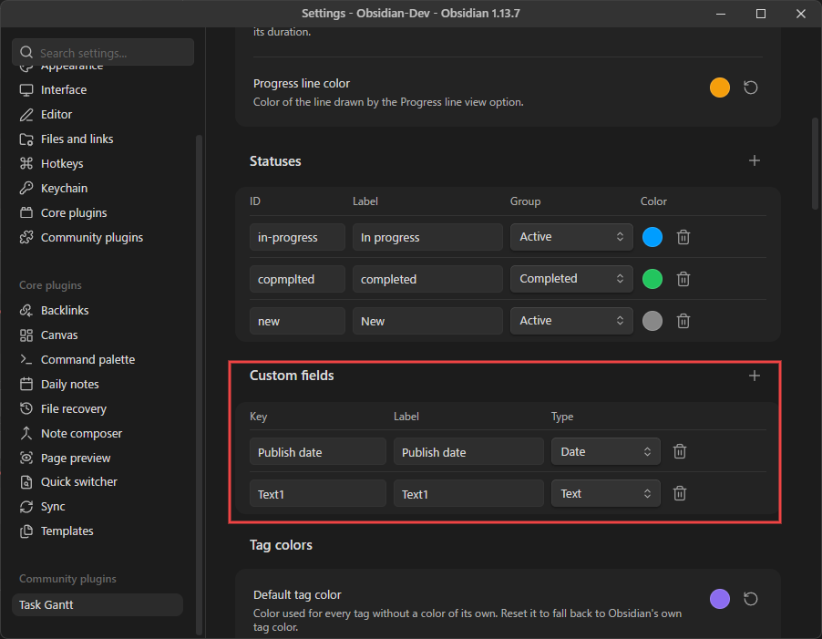

A new field's column is shown right away; hide or show it from the **Display** menu like any other column. Custom columns sort by clicking their header and are edited by double-clicking a cell, and every edit can be undone. Changing a field's key keeps its column's visibility, width and sort, and takes effect when you press Enter or leave the box. If notes still hold values under the old key, you're asked whether to rename that property in those notes too (a note that already has a value under the new key is never overwritten) or only to point the column at the new key. Keys the plugin already reads (the Start / Due / Status / … keys under **Frontmatter keys**, and `tags`) can't be used, and if two fields share a key only the first becomes a column — the settings tab says so.

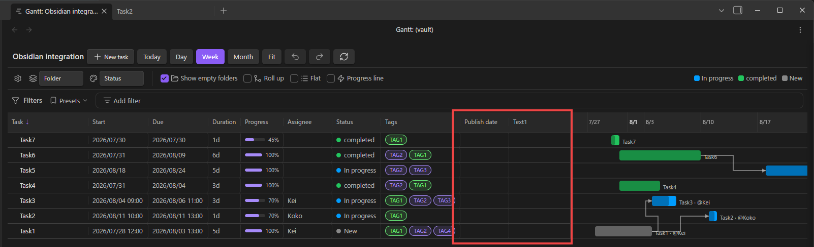

## Filters

A **filter row** below the options narrows the board. Click **Add filter** and pick a field — **Name**, **Status**, **Status group**, **Assignee**, **Tag**, **Start date**, or **Due date** — then set its condition. Each filter shows as a chip you can click to edit or remove with **×**.

- **Name** matches with *is / is not / contains / does not contain / starts with / ends with*.
- **Status / Status group / Assignee / Tag** let you tick several values — including **(none)** for unset — with *is / is not / is empty / is not empty*.
- **Start date / Due date** compare against a preset (yesterday/today/tomorrow), a specific date, a relative date (e.g. *1 week from now*, recomputed each day), or a date range, with *is / before / after / on or before / on or after / empty / not empty*.

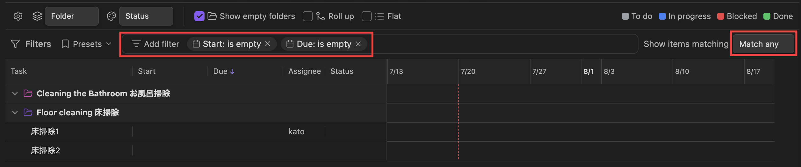

With two or more filters, choose **Show items matching → Match all** (AND) or **Match any** (OR) on the right.

### Presets

Open **Presets** for one-click filter sets. Built-in presets are **No dates (no bar)**, **Has dates**, **Overdue**, **Unassigned**, **Completed**, and **Incomplete**. The last two read the **status group** rather than status names: *Completed* is everything in the Completed group, and *Incomplete* is everything that is neither Completed nor Cancelled — active work, deferred work, and tasks with no status at all. Build any combination of filters and **save it as a preset** by typing a name — saved presets can be re-applied or deleted, and **Clear filters** removes them all. Filters and presets persist across sessions.

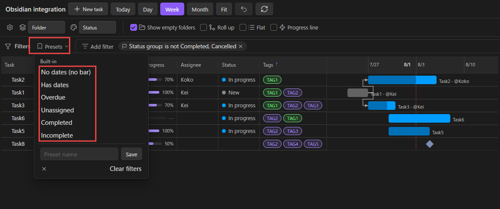

## Moving tasks between folders

When grouped by folder, **drag a task row** onto a folder to move the task into it (or onto another task to drop it into that task's folder). While you drag, the row under the pointer says what the drop will do, e.g. *Move to “Marketing”* or *Make subtask of “API”*. Without dragging, **right-click a task's name** (long-press on touch, Shift+F10 from the keyboard) for **Make subtask of…**, **Detach from parent**, **Move to folder…** and **Delete**. Links are updated automatically, and the move is **undoable** with **Ctrl/Cmd+Z** or the undo button. Empty folders stay visible as rows so you always have a drop target; the **Show empty folders** toggle (on by default) controls this.

## Subtasks

Give a task a `parent` (a single wikilink to another task) and it nests under that parent in the table, with a chevron to collapse or expand. When grouped by folder, **drag a task onto another task** to make it a subtask — it moves into the parent's folder with its whole subtree; **drag it onto a folder** to detach it back to the top level. Cycles are blocked, and every move is undoable. The **Roll up** toggle draws a parent's bar (and its Start/Due cells) as the span of its descendants. Set or clear the parent from the detail panel.

## Tags

Tasks use Obsidian's native `tags` (frontmatter `tags:` plus inline `#tag`), so they stay in sync with Obsidian's search and tag pane. **Group by Tag** to see a task under each of its tags — a multi-valued task appears in several groups — filter by tag, and show a **Tags** column of chips. When grouped by tag, **drag a task onto a tag group** to add that tag, distinct from a folder drop, which *moves* the task. Add or remove tags in the detail panel, or double-click the **Tags** cell to open the same editor there. Either way, tags are written to frontmatter `tags:` — a `#tag` written in the body is shown but can't be removed from here.

## Shared tasks (several assignees)

`assignee` can hold several people: write a list in the frontmatter, or add them one by one in the detail panel or the **Assignee** cell. A shared task shows a stacked avatar per person next to its bar and a people icon by its name, and **color by assignee** splits its bar into one band per person (each person on the board gets a color of their own, and up to ten people never share one; click a person in the legend to pick another). **Group by assignee** lists the task under each of its people; the copies are joined by a dotted line, and hovering one highlights them all. A row doesn't repeat its heading's person: under *Ana*, the label and the **Assignee** cell show only the others, after a plus (*Visual design + Ben*), and a task Ana has alone shows just its name. Grouping by tag likewise leaves the heading's tag out of its rows. Drag a task onto a person's group to add them — the task keeps its other assignees. With one assignee the value stays a plain string, so existing notes keep their shape.

## Coloring tags and folders

Every tag starts from a single **Default tag color** — Obsidian's own tag color unless you change it in **Settings → Task Gantt → Tag colors** — and you can override any individual tag on top of that. Folders get an automatic color from their name instead.

Colors are picked from a palette of 17, plus a rainbow swatch that opens your system's color picker for any hue. On the timeline, a task's tags follow its label as small pills tinted with each tag's color (up to three, then *+N*); turn them off with **Display → Tags on bars**.

**Right-click a folder heading, a tag heading, or a tag chip** to change or reset its color. Setting a color registers that tag under **Per-tag colors** in settings; resetting removes it again, so the list holds exactly the tags you have deliberately coloured — everything else follows the default. You can also add a tag there by picking it from your vault's tags, and removing one asks for confirmation, since the settings tab has no undo. Rows are listed alphabetically. Folder colors are right-click only.

<video src="https://github.com/katoiek/task-gantt/raw/main/docs/images/coloring_folder_tag.mp4" controls width="100%"></video>

> If the video doesn't play above, [watch it here](docs/images/coloring_folder_tag.mp4).

## Export as PNG

Choose **Export as PNG** from the view's **⋯** menu, or run the command, to save the whole board as an image, including rows scrolled out of view. It keeps the current theme and the **Display** menu's choices, adds the board's name and date on top and a color key for the current **Color by** underneath, and goes wherever your vault keeps attachments (a relative attachment setting is taken from the vault root, so nothing is added inside the board's folder). Each task is named once, in the image's left column (with a ✓ when it's completed, struck through when it's cancelled), so a bar is followed only by its people and tags; under a person's heading, only the other people on a shared task. A notice links to the file, or says why nothing was saved.

## Creating tasks

Press **＋ New task** to create a dated note in the current folder and rename it immediately. You don't have to start there, though: every note inside the target folder already appears as a row — **including notes with no dates yet** — so you can also click an existing note and set **Start** / **Due** in the detail panel to turn it into a scheduled task. Empty cells are double-click editable too, so you can fill a blank value straight from the table.

## Task kinds: note, Kanban, Canvas

A task is always a note — its frontmatter keeps the dates, status and the rest — but its content can be one of three kinds. Pick one from the **▾** next to **＋ New task**:

- **Note** (the default): the body is the task's description.
- **Kanban board**: the note is created in the [Kanban plugin](https://github.com/mgmeyers/obsidian-kanban)'s format, with one lane per status. The detail panel shows its lanes and cards in miniature; click them to open the board (as a board with the Kanban plugin installed, as Markdown otherwise). Its **progress is the share of checked cards**, counting every item in a lane as a card, as the board does: check cards on the board and the bar fills (the panel shows, say, *2 of 5 cards done*). It only reads 100% when every card is checked, and it isn't edited by hand while the board has cards.
- **Canvas**: a same-named `.canvas` is created next to the note, linked from its `canvas` key and embedded in the body, so the detail panel shows the canvas. Deleting the task deletes that canvas too, and undo brings both back.

The table marks Kanban and Canvas tasks with an icon. Any note counts as a Kanban task when its frontmatter has `kanban-plugin: board`, and as a Canvas task when its `canvas` key links to a `.canvas` file.

## Task frontmatter

Each task is a single Markdown file. The schedule lives in frontmatter; the description is the body.

```markdown
---
start: 2026-02-04
end: 2026-02-07
status: in-progress
assignee: kato
progress: 40
after:
  - "[[Sweeping]]"     # predecessor (dependency arrow)
---

# Wiping
The body is the task description (shown in the detail panel).
```

| Frontmatter | Meaning |
|-------------|---------|
| `start` / `end` | Start / end date `YYYY-MM-DD` (bar position and length). A time of day can be added as `YYYY-MM-DDTHH:mm+09:00` (edit via the detail panel; the offset follows the **Timezone** setting). |
| `status` | Status ID (defined in settings, reflected in bar color; its status group drives the Completed / Incomplete filters). |
| `assignee` | Assignee (avatar and label next to the bar) — one value, or a list for a [shared task](#shared-tasks-several-assignees). Each can be a note link such as `"[[John Doe]]"` — it's shown as a clickable link, and the note's name is used for the label, legend, filters and grouping. |
| `progress` | Progress 0–100 (fill inside the bar; editable with the detail-panel slider, or by double-clicking the **Progress** column). |
| `after` | Array of wikilinks to predecessors (dependency arrows; violations turn red). |
| `milestone` | `true` for a diamond (zero duration). |
| `gcal` | `true` opts the task into [Google Calendar sync](#google-calendar-sync-optional-desktop-only) (only used when **Sync flagged tasks only** is on). |
| `gcalId` | Set automatically once the task is pushed to Google Calendar — the linked event's ID. Don't edit by hand. |
| `canvas` | Link to a [Canvas task](#task-kinds-note-kanban-canvas)'s `.canvas` (set when the task is created). |

**Milestones:** a task that has only an `end` date (no `start`) is automatically treated as a milestone and drawn as a diamond. Setting `milestone: true` does the same. To turn a milestone back into a ranged task, give it a `start` date.

The task name is the file name (without extension); the group is the parent subfolder name. Frontmatter key names can be changed in settings.

Sample data for a quick try lives in `examples/Cleaning Project お掃除プロジェクト/` (point the target folder at it).

## Dependencies

Drag from a bar's round handle to another bar to create a dependency, or use **Add dependency…** in the detail panel: pick the type, then the task this one waits on. The connected ends decide the type: **FS** (finish→start), **SS** (start→start), **FF** (finish→finish). SS/FF successors snap to their predecessor when you reschedule. An FS successor is **pushed later when its predecessor slips into it** — it moves to the next workday after the predecessor's due date and keeps its duration — and the push carries on down the chain. Moving a predecessor earlier never pulls its successors back, so gaps you left on purpose stay. Turn this off with **Push FS successors automatically** in settings. Milestones never move through dependencies. To remove a dependency, hover its line and click the **×** that appears, or use the × on it in the detail panel; a notice offers **Undo** (so do **Ctrl/Cmd+Z** and the undo button). Clicking the line itself does nothing, so a stray click can't break a link. With **Display → Dependency arrows** off, a task whose dependency is broken still shows it with a red outline.

## Duration

The **Duration** column (turn it on from the **Display** menu) shows how many **workdays** a task spans, counting both ends and skipping the non-working days set in settings (Saturday and Sunday by default). It isn't stored anywhere: it's worked out from `start` and `end`, which stay the source of truth.

- **Change the duration** (double-click the cell, or use the field in the detail panel) and the start stays put while the due date moves. A task with no start date starts today.
- **Change only the start date** and the due date moves with it, so the duration stays the same — the bar slides. Changing the due date changes the duration instead. Dragging a bar's edge on the timeline resizes it as before.
- Together with FS dependencies you can schedule by duration: give each task a duration, chain them with FS links, and a slipping task pushes everything after it.

## Undo and redo

Every change made on the board can be undone with **Ctrl/Cmd+Z** or the undo button, and redone with **Ctrl/Cmd+Shift+Z**, **Ctrl/Cmd+Y** or the redo button: cell edits, everything in the detail panel (including renames and body text), dragging bars, dependencies, moves and subtasks, tags, and creating or deleting a task. Undoing a delete re-creates the note in place. Successors that moved along with a task move back with it. While you are typing in a text field, the shortcuts undo your typing instead. Renaming or moving the board's tasks or folders from the file explorer joins the history too, so undo always walks back in the order things happened. The history lasts while the board is open.

Changes made **outside Obsidian** — renaming, moving or deleting notes in Windows Explorer or macOS Finder, or by a sync tool — are not part of the history: Obsidian only sees them as a file disappearing and another appearing. Undoing an earlier change to such a note does nothing, so rename and move tasks inside Obsidian (the title field, or Obsidian's own file explorer) if you want to be able to undo it.

## Settings

Open **Settings → Task Gantt** to configure the default folder, subfolder recursion, default zoom, and the **date display format** (`YYYY/MM/DD`, `DD/MM/YYYY`, or `MM/DD/YYYY`; stored dates always stay ISO `YYYY-MM-DD`).

The **Timezone** setting (system or a fixed GMT offset, listed with representative cities) controls how times of day are displayed and saved. Changing it re-displays stored times in the new offset.

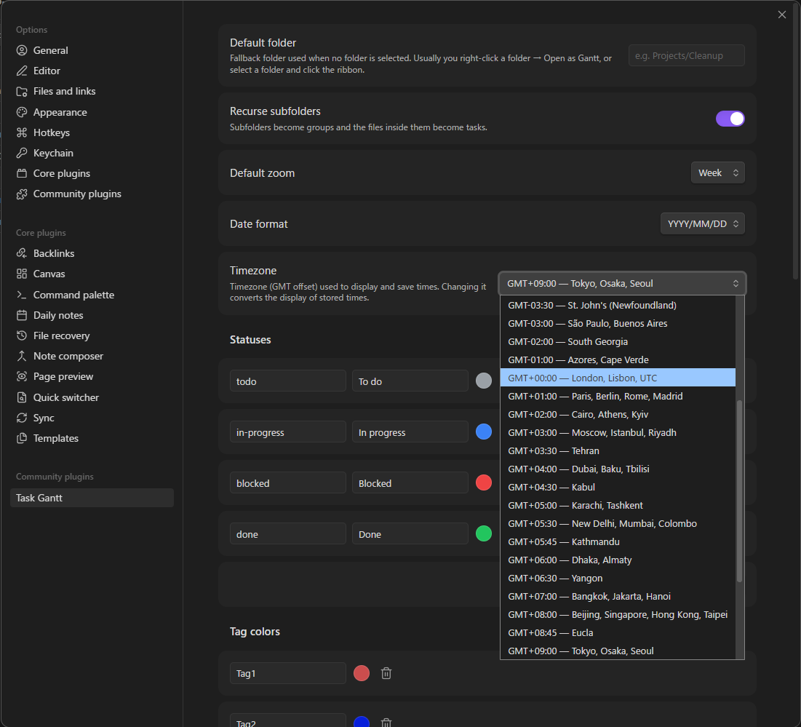

**Non-working days** (Saturday & Sunday, Friday & Saturday, Sunday only, or none) are skipped when counting a task's duration and when dependencies move tasks. **Push FS successors automatically** (on by default) controls whether a slipping predecessor pushes its FS successors.

The **Progress line color** setting sets the color of the jagged line drawn by the **Progress line** view option, with a button to reset it to the default amber.

**Statuses are fully customizable** — add, edit, or delete them, here or straight from the legend on the board. Each status has an **id** (matches the `status` frontmatter value), a **label**, a **group**, and a **color** reflected in the bar.

The **group** is what tells the plugin whether a task is finished. There are four, borrowed from Wrike and not extensible: **Active** (being worked on), **Completed** (done), **Deferred** (paused — on hold, blocked, waiting), and **Cancelled** (dropped). Every status belongs to exactly one, and the *Completed* / *Incomplete* filter presets read only the group, never the status name — so a status called `Shipped` counts as finished as long as it sits in the Completed group. If no status is in the Completed group, settings say so and the *Completed* preset stays empty.

> Upgrading from 2.8.x: existing statuses are assigned a group once, guessed from their id and label (`done`/`完了` → Completed, `cancelled`/`中止` → Cancelled, `on hold`/`blocked`/`保留` → Deferred, everything else → Active). Check the list after upgrading and correct anything the guess got wrong.

You can also rename the **frontmatter keys** the plugin reads (start, end, status, assignee, after, progress, milestone, canvas) to match your own vault conventions.

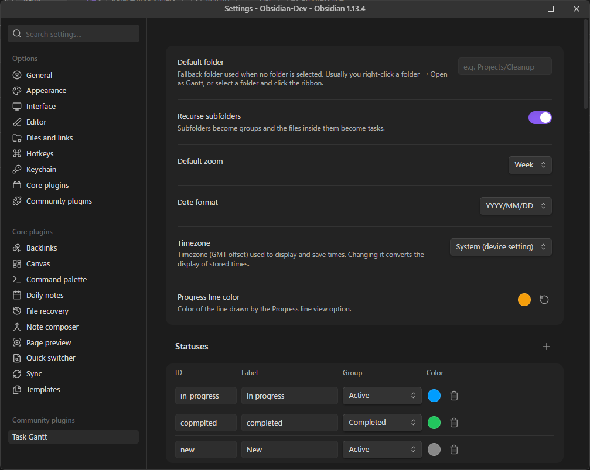

## Notifications (optional)

Task Gantt can post reminders for tasks that have a **time of day** to **Discord** and/or **Slack** via incoming webhooks. In **Settings → Task Gantt → Notifications**, set the webhook URLs, choose the targets (start / due), and pick the lead times (1 week / 1 day / 1 hour / 10 minutes before, or at the exact time). Use **Send a test message** to verify the webhook instantly.

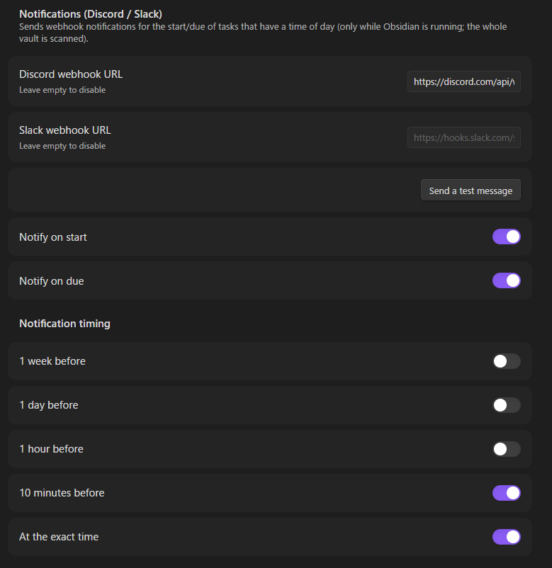

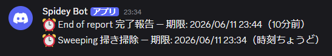

- **Network use**: when enabled, the plugin sends HTTP POST requests containing only the task name and its date/time to the webhook URLs you configured — nothing else is sent, and nowhere else. Leaving both URLs empty (the default) disables all network access.
- Notifications fire only while Obsidian is running. Triggers that passed while Obsidian was closed are skipped, and each trigger is sent at most once.
- Date-only tasks (without a time of day) are never notified.
- The whole vault is scanned — no folder configuration needed; any task with a time of day qualifies.

## Google Calendar sync (optional, desktop only)

Task Gantt can keep tasks and a Google calendar in **two-way sync**: task changes (create / reschedule / delete) are pushed as events, and moving or deleting those events in Google Calendar flows back into the task's frontmatter. Each direction can be toggled independently in **Settings → Task Gantt → Google Calendar**.

### Setup

The plugin has no server, so it uses **your own Google Cloud project**:

1. In [Google Cloud Console](https://console.cloud.google.com/), create a project and enable the **Google Calendar API**.
2. Configure the OAuth consent screen (External is fine) and add your own Google account as a **test user**. Because the app is yours and unverified, Google shows an "unverified app" warning during consent — expected, just continue.
3. Create an **OAuth client ID** of type **Desktop app**, and paste the client ID and secret into the plugin settings.
4. Press **Connect** — your browser opens Google's consent screen, and the plugin receives the authorization on `127.0.0.1` (loopback). Then pick the **calendar to sync** (a dedicated calendar is recommended).

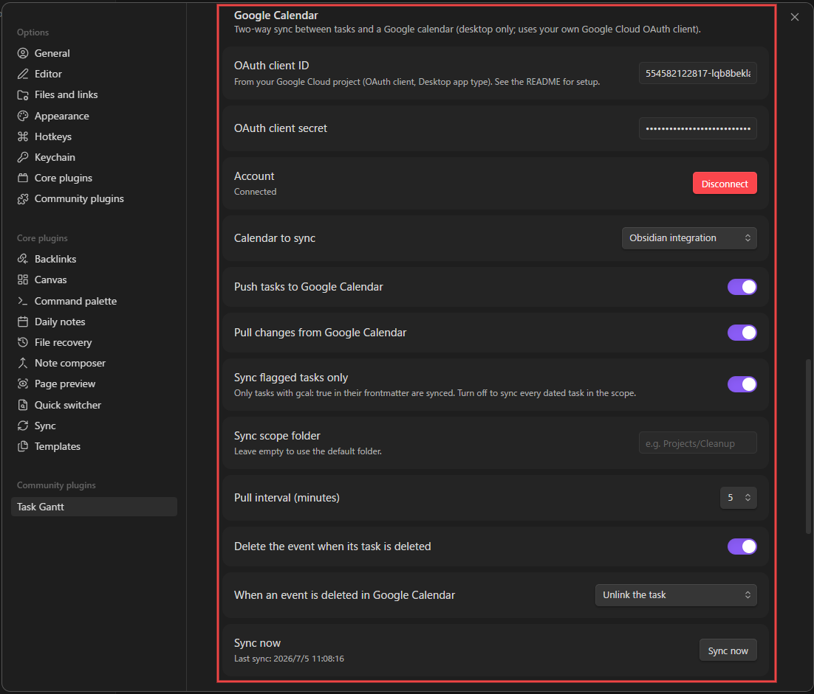

### How it syncs

- **Pull only ever touches events that Task Gantt itself created.** Creating an event directly in Google Calendar does **not** create a task, and editing or deleting a foreign (non-plugin) event is ignored — the plugin only reads back changes to events it pushed. Anything already on your calendar is left untouched.
- By default only tasks with the **`gcal: true`** flag in their frontmatter sync (**opt-in**; toggle it per task in the detail panel — which also shows an **Open in Google Calendar** link once synced). Turn off **Sync flagged tasks only** to sync every dated task in the scope folder instead.
- Date-only tasks become **all-day events**; tasks with a time of day on both ends become timed events (using the plugin's **Timezone** setting); milestones become one-day events. The linked event's ID is stored in the task's `gcalId` frontmatter key (set automatically — don't edit it by hand).
- Local edits push within seconds; remote changes are pulled at the configured interval (default 5 minutes). Titles sync one way only (task → event): renaming the event in Google Calendar is reverted on the next push, since renaming files from outside is risky.
- If both sides changed since the last sync, the **newer edit wins** and a notice tells you which side was kept.
- Deleting a task deletes its event (configurable). Deleting the event in Google Calendar just **unlinks** the task by default (optionally also clearing its dates) — files are never deleted.
- Recurring events are not supported (skipped by both directions).

**Example** — `Test1` and `Test2` carry `gcal: true` and pushed through as events; `Test3 (no flag)` stayed local only. The `Test3 from GC` event and the `七夕` holiday were created directly in Google Calendar and never became tasks:

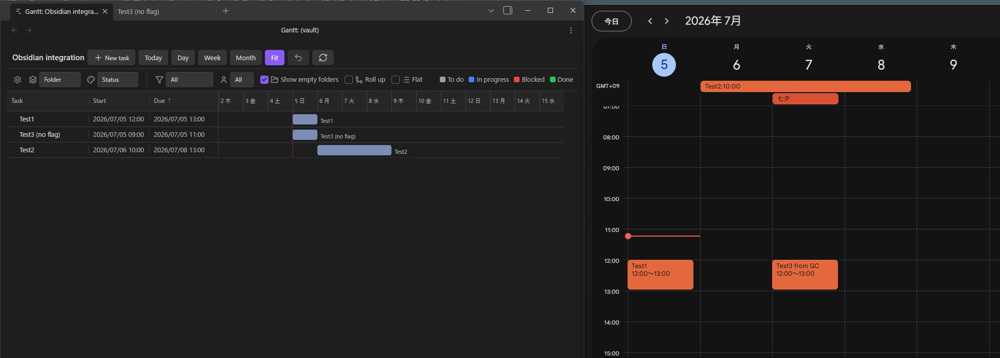

### Disclosure

- **Network use**: when connected, the plugin talks to Google's OAuth and Calendar APIs only, sending the synced tasks' name, dates, and a body excerpt (first 500 characters) with a link back to the note. Leaving the feature unconfigured (the default) makes no network requests.
- **Account & credentials**: requires a Google account and your own Google Cloud OAuth client. The plugin requests only the `calendar.events` and `calendar.calendarlist.readonly` scopes. The OAuth **client secret and refresh token are stored in Obsidian's secret storage** (the OS keychain), not in the plugin's `data.json`, so they don't travel with vault sync, backups, or git. Only the client ID stays in `data.json`. Secret storage is per device, so connect again on each device. Upgrading from 2.9.3 or earlier moves the old plain-text values out of `data.json` automatically; if that file was ever committed to git or shared, reset the client secret in Google Cloud Console and reconnect.
- Mobile is not supported (the OAuth loopback needs a desktop); other features work on mobile as usual.

## Vault access

To build the board, the plugin lists the Markdown files in your vault and reads their frontmatter through Obsidian's metadata cache. When the board is opened on a folder, only notes under that folder are shown, but notifications look at the whole vault, and renaming a custom field's key searches every note for that key. Nothing read this way leaves your device; the only network use is the optional notifications and Google Calendar sync described above.

## Development

```bash
npm install      # install deps
npm run dev      # watch build
npm run build    # type-check + production build
npm test         # headless model tests
```

Copy `main.js` / `manifest.json` / `styles.css` into `<vault>/.obsidian/plugins/task-gantt/` to enable it.

## Design

See [`docs/adr/`](./docs/adr/) for the rationale behind design decisions (latest: ADR-0005) and [`CONTEXT.md`](./CONTEXT.md) for terminology.

## Limitations

Auto-scheduling (critical path), sub-day time granularity, and cross-folder aggregation are not implemented. Custom fields can't be used in filters yet.

## License

MIT — see [`LICENSE`](./LICENSE).

---

# 日本語

[English](#task-gantt) | **日本語**

プロジェクト管理ツールのようなタスク管理 UI を Obsidian で実現するプラグインです。**1 ファイル = 1 タスク**とし、指定フォルダ配下を **「表＋タイムライン」ガント**で表示・編集します。バーのドラッグで日程変更、依存の作成、マイルストーン、ソート・フィルタ、ドラッグでのフォルダ移動などができます。

> **Obsidian 1.11.4 以降**が必要です。

## スクリーンショット

左列のリボンボタン、またはフォルダの右クリック →**「Open as Gantt」**から Gantt として開きます：


「表＋タイムライン」で開き、グループ・バー・マイルストーン・依存の矢印が表示されます：


タスクをクリックすると詳細パネルが開き、日付・状態・担当・進捗・本文を編集できます：


## 使い方

1. **設定 → Task Gantt** で**対象フォルダ**を指定（例: `Projects/お掃除`）。
2. 左列の **「Gantt を開く」リボンアイコン**（またはコマンド「Gantt を開く」）でビューを開く。リボンは、**現在開いているノートのフォルダ**（またはエクスプローラで選択中のフォルダ）を Gantt 表示し、どちらも無ければ設定の既定フォルダ（未設定なら **Vault ルート**）を開きます。フォルダを右クリック →**「Open as Gantt」**でも開けます。
3. 直下のサブフォルダが**グループ**、その中の `.md` が**タスク**になります。
4. バーを**ドラッグ／端をリサイズ**すると、そのファイルの `start`/`end` に書き戻します。**テーブルに表示できる列はすべて、セルをダブルクリックすればその場で編集できます**（シングルクリックは行の選択。編集できるセルにはホバーで鉛筆が出ます）。 開始・期限はカレンダー、期間は稼働日数の入力、進捗は % の直接入力（0–100。空欄または 0 で未設定）、ステータスはドロップダウン、担当者とタグは詳細パネルと同じエディタ（値ごとのチップと × による削除＋追加欄。担当者はボード内で既に使われている名前を、タグは Vault 内の既存タグを候補に出し、担当者は `[[` でノートへのリンクにもできます）が開きます。Enter またはフォーカスを外すと保存、Esc で取消します。
5. 表のタスクかバーをクリックすると**詳細パネル**（日付・ステータス・担当者・依存・進捗・本文）が開きます。パネルはボードを覆わず横に並び、他の場所での変更にも追従し、× か **Esc** で閉じます。バーにマウスを載せると概要カード（日付・期間・ステータス・進捗・担当者）が出ます。
6. **＋ 新規タスク**ボタンで現在のフォルダに1日タスクを作ってその場で命名（横の **▾** から[カンバン・キャンバス](#タスクの種類ノートカンバンキャンバス)のタスクも作れます）、**今日**ボタンでタイムラインを今日へスクロールできます。
7. **Day / Week / Month / Fit** ボタンで時間軸の拡大率を変更（画面中央の日付はそのまま）。**Fit** はペイン幅に自動で収め、リサイズにも追従します。軸の日付は Obsidian の表示言語に従い、その上に月（Month では年）の帯が付き、休日は網掛けされます。左上のフォルダ名から別のフォルダのボードへ切り替えられます。
8. **キーボード**：表では ↑/↓（と Home/End・Page Up/Down）で行を移動、→/← で開閉、**Enter** で詳細パネル（グループは開閉）、**F2** で名前の変更、**Shift+F10** かメニューキーで行のメニュー。**Esc** でパネルを閉じて元の行に戻ります。

UI 表示は Obsidian の表示言語に追従します。対応言語：英語・日本語・韓国語・中国語（簡体／繁体）・フランス語・スペイン語・ロシア語（その他は英語にフォールバック）。

## 表示オプション

ツールバーの右端の **グループ化**・**色分け**・**表示** メニューで、ボードの見せ方を調整できます。ツールバーの下の細い行は色の凡例です。

**グループ化**（フォルダ／ステータス／担当者／タグ）と**色分け**（ステータス／担当者）。**表示** メニューには、ときどき切り替えるものが 3 つの区分にまとまっています：**タイムライン**（**依存の矢印**・**バーのタグ**・**稲妻線**）、**行の表示**（**フラット表示**・**ロールアップ**・**空フォルダを表示**）、表に出す**列**。これらと折りたたんだグループはボードごとに記憶されます。たまにしか使わない **PNG として書き出す** と **再読み込み** は、ビューの **⋯** メニューとコマンドパレットにあります。ステータスは色だけに頼らず、完了はラベルに ✓、延期は斜線、キャンセルは薄く取り消し線で示します。

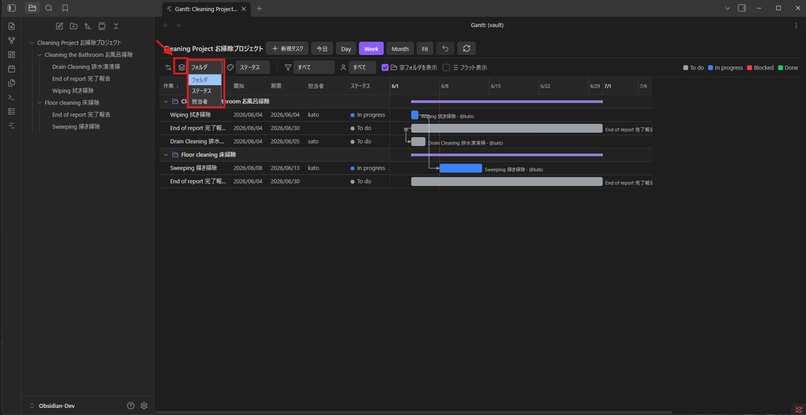

グループの見出しには、グループ化の軸に合わせたアイコン（フォルダ・人・ステータスの丸・タグ）が付きます。**見出しを右クリック**すると色を選べるほか、Obsidian のアイコン一覧（検索可）から好きなアイコンを付けられます（例：ある人の作業をまとめたフォルダに人のアイコン）。凡例の**ステータスをクリック**すると名前・色・グループの変更や削除ができ、**＋** でステータスを追加できます。担当者で色分け中は、凡例の人をクリックしてその人の色を選べます。

**ソート**は列ヘッダをクリック。もう一度クリックで昇順／降順を切替（↑/↓）：

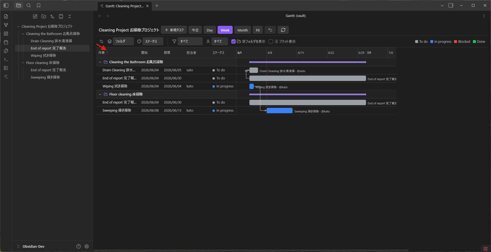

**列の表示**は **表示** メニューから、開始・期限・期間・進捗・担当者・ステータス・タグを出し分け。ここに出せる列はすべてセルのダブルクリックで編集できます。列レイアウトとソートはセッションをまたいで保存されます：

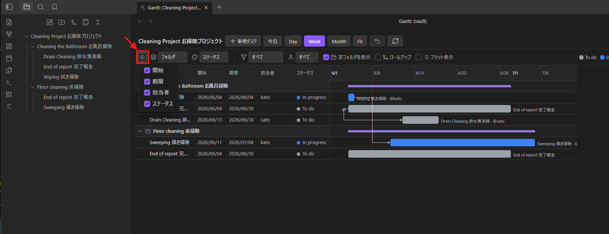

**フラット表示**は、フォルダや入れ子を無視して全タスクを1本のソート済みリストで表示します：

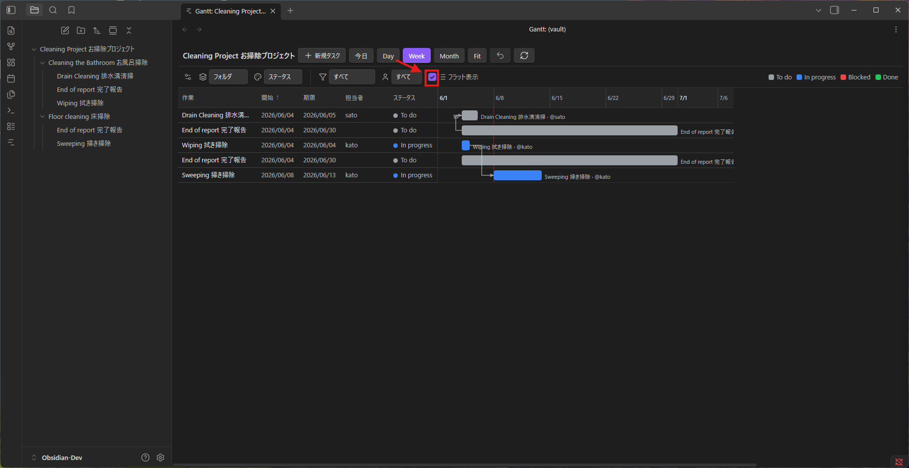

**稲妻線**は、今日を基準にした垂線を各タスクの実績到達点まで折り曲げた折れ線です。**今日より左に折れれば遅れ、右なら進み**を意味します。各行の点は、タスクの `progress` に対応するバー上の位置に置かれます（先週が期限なのに 40% のタスクは、線をその 40% 地点まで引き戻します）。100% のタスク、まだ開始日が来ていない未着手タスク、フォルダ行、ロールアップ中の親バーは今日線上を素通りします。開始日を過ぎているのに進捗 0% のタスクは、線を開始日まで引き戻します。線の色は**設定 → Task Gantt → 稲妻線の色**で変更できます。

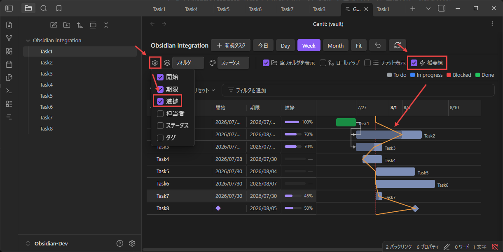

## カスタムフィールド

任意のフロントマターのキーを、テーブルの列として表示できます。**設定 → Task Gantt → カスタムフィールド**で**フィールドを追加**を押し、**キー**（フロントマターのプロパティ名。例: `client`）、列見出しに使う**表示名**（省略可）、**種類**を指定します。

- **テキスト** — そのまま表示します。リストの値はカンマ区切りで表示し、編集するとリストのまま書き戻します。
- **数値** — 右揃えで表示し、数値として並べ替えます。
- **日付** — 設定の日付形式で表示し、開始・期限と同じカレンダーで編集します（日付部分のみ）。

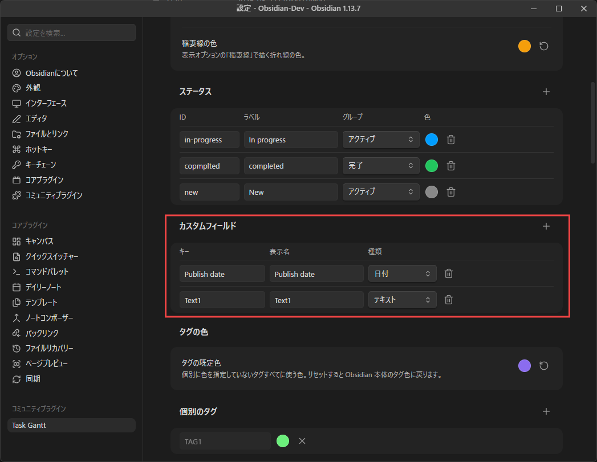

追加したフィールドの列はすぐに表示され、ほかの列と同じく **表示** メニューで表示を切り替えられます。見出しのクリックで並べ替え、セルのダブルクリックで編集でき、編集はすべて取り消せます。キー名を変えても、列の表示・幅・並べ替えの設定はそのまま残ります。キーの変更は Enter を押すか入力欄を離れたときに反映され、旧キーの値を持つノートがあれば、ノート側のプロパティ名も変えるか（新しいキーに既に値があるノートは上書きしません）、列が読むキーだけを変えるかを尋ねます。プラグインが既に使っているキー（**フロントマターのキー名**にある開始・期限・ステータスなどのキーと `tags`）は使えません。また、同じキーのフィールドが複数あるときは最初の 1 つだけが列になります。どちらも設定画面に注意書きが出ます。

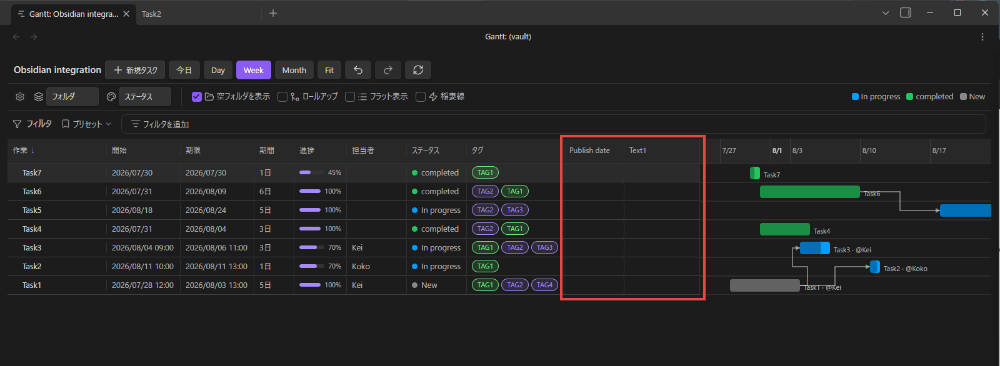

## フィルタ

オプション行の下の**フィルタ行**でボードを絞り込めます。**フィルタを追加**から項目（**名前**／**ステータス**／**ステータスグループ**／**担当者**／**タグ**／**開始日**／**期限日**）を選び、条件を設定します。各フィルタはチップで表示され、クリックで編集、**×**で削除できます。

- **名前**：と一致／以外／を含む／を含まない／で始まる／で終わる
- **ステータス／ステータスグループ／担当者／タグ**：複数値をチェックで選択（**（なし）＝未設定**も選べます）。と一致／以外／未設定／設定あり
- **開始日／期限日**：プリセット（昨日・今日・明日）／具体的な日付／相対的な日付（例：*1 週間後*・毎日再計算）／期間と比較。と一致／より前／より後／以前／以後／未設定／設定あり

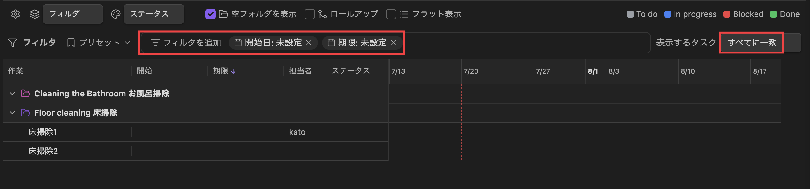

フィルタが2件以上あるときは、右端の **表示するタスク → すべてに一致**（AND）／**いずれかに一致**（OR）で結合方法を選べます。

### プリセット

**プリセット**からワンクリックでフィルタ構成を切り替えられます。組み込みプリセットは **日付なし（バーなし）／日付あり／期限切れ／未割り当て／完了済み／未完了**。後ろの 2 つはステータス名ではなく**ステータスグループ**を見ます：**完了済み**は完了グループのタスク、**未完了**は完了でもキャンセルでもないタスク（アクティブ・延期・ステータス未設定）です。任意のフィルタ構成に名前を付けて**プリセットとして保存**でき、保存したプリセットは再適用・削除が可能です。**フィルタをクリア**で全解除。フィルタとプリセットはセッションをまたいで保存されます。

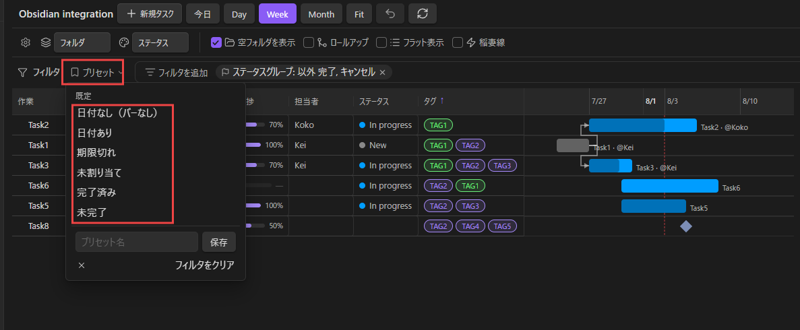

## フォルダ間のタスク移動

フォルダでグループ化しているとき、**タスク行をドラッグ**してフォルダにドロップするとそのフォルダへ移動できます（別タスクへドロップすると、そのタスクと同じフォルダへ）。ドラッグ中は、ポインタの下の行にドロップの結果（*「Marketing」へ移動*、*「API」のサブタスクにする* など）が表示されます。ドラッグしなくても、**タスク名を右クリック**（タッチは長押し、キーボードは Shift+F10）で **サブタスクにする…**・**親タスクから外す**・**フォルダへ移動…**・**削除** を選べます。リンクは自動更新され、移動は **Ctrl/Cmd+Z** または取り消しボタンで**元に戻せます**。空のフォルダも行として表示されるので常にドロップ先になります（**空フォルダを表示**トグル＝既定ON で切替）。

## サブタスク

タスクに `parent`（別タスクへの単一 wikilink）を与えると、表でその親の下に入れ子表示され、シェブロンで折りたたみできます。フォルダでグループ化中は、**タスクを別タスクへドラッグ**するとサブタスク化（親のフォルダへサブツリーごと移動）、**フォルダへドラッグ**すると親を解除してトップレベルへ戻します。循環は禁止され、移動はすべて取り消し可能です。**ロールアップ**トグルで、親のバー（と開始・期限セル）を子孫全体の範囲として描けます。親の設定・解除は詳細パネルからも行えます。

## タグ

タスクは Obsidian ネイティブの `tags`（フロントマター `tags:` ＋本文 `#tag`）を使うので、Obsidian の検索・タグペインと同期します。**タグでグループ化**すると、各タグの下にそのタスクが表示され（多値のタスクは複数グループに登場）、タグでの絞り込みや、チップ表示の**タグ列**も使えます。タグでグループ化中は、**タスクをタグのグループへドラッグ**するとそのタグを付与できます（フォルダへのドロップ＝移動とは別動作）。タグの追加・削除は詳細パネル、または**タグ**セルのダブルクリックで同じエディタを開いて行えます。どちらもフロントマターの `tags:` に書き込むため、本文中に書いた `#tag` は表示されますがここからは削除できません。

## 共有タスク（複数の担当者）

`assignee` には複数の人を入れられます。フロントマターにリストで書くか、詳細パネルや**担当者**セルで 1 人ずつ追加します。共有タスクはバーの横に人数分のアバターが重なって並び、名前の前に人のアイコンが付きます。**担当者で色分け**すると、バーが一人ひとりの色の帯に分かれます（ボードの一人ひとりに別の色が自動で付き、10 人までは同じ色になりません。凡例の人をクリックすれば別の色を選べます）。**担当者でグループ化**すると、そのタスクは担当者それぞれのグループに並び、同じタスクどうしは点線でつながり、どれかにマウスを載せるとまとめて強調されます。行では見出しの人を繰り返しません。*Ana* の下では、ラベルと**担当者**セルにほかの人だけが「+」付きで出て（*Visual design + Ben*）、Ana だけのタスクは名前だけになります。タグでグループ化したときも、見出しのタグは行に出しません。タスクを人のグループへドラッグするとその人を追加します（ほかの担当者はそのまま）。担当者が 1 人のときは値は従来どおり文字列のままなので、既存のノートの書き方は変わりません。

## タグ・フォルダの色

タグの色はすべて **タグの既定色** を土台にし、そこから個別に上書きします。既定色は **設定 → Task Gantt → タグの色** で指定でき、未設定なら Obsidian 本体のタグ色に従います。フォルダは従来どおり名前から自動で色が付きます。

色は 17 色のパレットから選べ、虹色の見本を押すとシステムの色選択が開いて好きな色合いを選べます。タイムラインでは、タスクのタグがラベルの後ろに小さな札で、それぞれのタグの色で控えめに並びます（3 つまで。それ以上は *+N*）。**表示 → バーのタグ** で隠せます。

**フォルダの見出し・タグの見出し・タグのチップを右クリック**して、色の変更／リセットができます。色を指定すると、そのタグが設定の**個別のタグ**に登録され、リセットすると登録が外れます。つまり一覧には**自分で色を決めたタグだけ**が並び、それ以外は既定色に従います。設定側からは Vault のタグを選んで追加でき、削除には確認が入ります（設定画面には取り消しが無いため）。並びはタグ名順です（フォルダの色は右クリックのみ）。

<video src="https://github.com/katoiek/task-gantt/raw/main/docs/images/coloring_folder_tag.mp4" controls width="100%"></video>

> 上で動画が再生されない場合は [こちら](docs/images/coloring_folder_tag.mp4) からご覧ください。

## PNG として書き出す

ビューの **⋯** メニュー（またはコマンド）の **PNG として書き出す** で、画面外の行も含めたボード全体を画像として保存できます。今のテーマと **表示** メニューの設定のまま、上にボード名と日付、下に今の **色分け** の凡例が付き、Vault の添付ファイルの置き場所に保存されます（相対の設定は Vault のルートから決まるので、ボードのフォルダの中には何も増えません）。タスク名は画像の左の列に 1 度だけ出し（完了は ✓ 付き、キャンセルは取り消し線）、バーの後ろには担当者とタグだけを出します。人の見出しの下では、共有タスクのほかの人だけです。通知からファイルを開けるほか、保存できなかったときは通知でそう伝えます。

## タスクの作成

**＋ 新規タスク**で現在のフォルダに日付付きノートを作り、すぐ名前を付けられます。もちろんそこから始める必要はありません。対象フォルダ内のノートは、**まだ日付が無いものも含めて**そのまま行として表示されるので、既存ノートをクリックして詳細パネルで **開始 / 期限** を入力すれば、そのままスケジュール付きタスクになります。各セルは**値が空のままでもダブルクリックで編集できる**ので、表から直接入力しても構いません。

## タスクの種類：ノート・カンバン・キャンバス

タスクは常に 1 つのノートで、日付やステータスなどはフロントマターが持ちます。そのうえで中身を 3 種類から選べます。**＋ 新規タスク**の横の **▾** から選んでください：

- **ノート**（既定）：本文がタスクの説明です。
- **カンバン**：[Kanban プラグイン](https://github.com/mgmeyers/obsidian-kanban)の形式で、ステータスごとの列を持つノートを作ります。詳細パネルには列とカードが縮小表示され、クリックするとボードが開きます（Kanban プラグインがあればボードとして、無ければ Markdown として）。**進捗はチェックしたカードの割合**で、ボードと同じく列の中の項目はすべてカードとして数えます。ボードでカードをチェックするとバーが伸びます（パネルには *カード 5 枚中 2 枚が完了* のように出ます）。100% になるのは全部チェックしたときだけで、カードがある間は手で編集しません。
- **キャンバス**：ノートと同じ名前の `.canvas` を隣に作り、`canvas` キーでリンクして本文に埋め込むので、詳細パネルにキャンバスが表示されます。タスクを削除するとそのキャンバスも削除され、取り消せば両方が戻ります。

表では、カンバンとキャンバスのタスクにアイコンが付きます。フロントマターに `kanban-plugin: board` があるノートはカンバン、`canvas` キーが `.canvas` にリンクしているノートはキャンバスとして扱います。

## タスクの書き方

各タスクは 1 つの Markdown ファイル。スケジュールはフロントマター、説明は本文に書きます。

```markdown
---
start: 2026-02-04
end: 2026-02-07
status: in-progress
assignee: kato
progress: 40
after:
  - "[[掃き掃除]]"     # 先行タスク（依存＝矢印）
---

# 拭き掃除
本文がタスクの説明（詳細パネルに表示）。
```

| フロントマター | 意味 |
|----------------|------|
| `start` / `end` | 開始 / 終了日 `YYYY-MM-DD`（バーの位置と長さ）。`YYYY-MM-DDTHH:mm+09:00` 形式で時刻も設定可（詳細パネルで編集。オフセットは**タイムゾーン**設定に従う） |
| `status` | ステータス ID（設定で定義、バー色に反映。所属する**ステータスグループ**が完了済み／未完了フィルタの根拠） |
| `assignee` | 担当者（バー脇にアバターとラベルを表示）。1 人なら値、複数ならリスト（[共有タスク](#共有タスク複数の担当者)） |
| `progress` | 進捗 0–100（バー内の塗り。詳細パネルのスライダー、または**進捗**列のダブルクリックで編集） |
| `after` | 先行タスクへの wikilink 配列（依存＝矢印、違反は赤） |
| `milestone` | `true` で菱形（期間ゼロ） |
| `gcal` | `true` で **Google カレンダー同期**（後述）の対象にする（**フラグ付きタスクのみ同期**がオンのときだけ判定に使用） |
| `gcalId` | タスクを Google カレンダーへ Push すると自動で入る、紐付け先イベントの ID。手動編集不可 |
| `canvas` | [キャンバス](#タスクの種類ノートカンバンキャンバス)型タスクの `.canvas` へのリンク（作成時に自動で入る） |

**マイルストーン：** `end`（終了日）だけがあり `start`（開始日）が無いタスクは、自動的にマイルストーンと判定され菱形で描画されます。`milestone: true` でも同じです。通常タスクに戻すには `start`（開始日）を与えてください。

タスク名はファイル名（拡張子なし）。グループは直上のサブフォルダ名。フロントマターのキー名は設定で変更できます。

`examples/Cleaning Project お掃除プロジェクト/` に動作確認用のサンプルがあります（対象フォルダにそれを指定）。

## 依存関係

バーの丸ハンドルから別のバーへドラッグするか、詳細パネルの **先行タスクを追加…** で種類を選んでから先行タスクを選ぶと依存を作成します。つないだ端で種類が決まります：**FS**（終了→開始）・**SS**（開始→開始）・**FF**（終了→終了）。SS/FF の後続は、先行の日程変更に追従します。FS の後続は、**先行が遅れて重なったときに後ろへ押し出されます**。先行の期限日の次の稼働日へ移り、期間はそのまま保たれます。押し出しはその先の後続へも連鎖します。先行を前倒ししても後続は引き戻されないので、わざと空けた間隔は残ります。この動作は設定の **FS の後続を自動で押し出す** でオフにできます。マイルストーンは依存では動きません。依存を外すには、線にマウスを載せて出る **×** をクリックするか、詳細パネルの依存の × を押します。通知の **取り消し**（または **Ctrl/Cmd+Z**・取り消しボタン）で戻せます。線そのもののクリックでは外れないので、誤クリックで依存が消えることはありません。**表示 → 依存の矢印** をオフにしていても、依存が守られていないタスクは赤い縁で分かります。

## 期間（Duration）

**期間**列（**表示** メニューで表示）は、タスクが何**稼働日**かかるかを表示します。両端の日を含めて数え、設定した休日（既定は土・日）は数えません。期間はどこにも保存されず、`start` と `end` から計算します（日付が常に正です）。

- **期間を変える**（セルのダブルクリック、または詳細パネルの欄）と、開始日はそのままで期限日が動きます。開始日が無いタスクは今日から始まります。
- **開始日だけを変える**と、期限日も一緒に動き、期間が保たれます（バーが平行移動します）。期限日を変えた場合は期間が変わります。タイムラインでバーの端をドラッグしたときは、これまでどおり伸び縮みします。
- FS 依存と組み合わせると 期間でスケジュールを組めます。各タスクに期間を入れて FS でつなげば、遅れたタスクがその後ろをまとめて押し出します。

## 取り消し・やり直し

ボード上の変更は、**Ctrl/Cmd+Z** または取り消しボタンで元に戻し、**Ctrl/Cmd+Shift+Z**・**Ctrl/Cmd+Y** またはやり直しボタンでやり直せます。対象はセルの編集、詳細パネルのすべての項目（名前の変更・本文を含む）、バーのドラッグ、依存、移動・サブタスク化、タグ、タスクの作成・削除です。削除を取り消すと、ノートが同じ場所に作り直されます。一緒に動いた後続も、まとめて元に戻ります。テキスト入力中は、ショートカットは入力内容の取り消しとして働きます。ファイルエクスプローラーでボードのタスクやフォルダをリネーム・移動した場合も履歴に入るので、取り消しは常に起きた順に遡ります。履歴はボードを開いている間保持されます。

**Obsidian の外**で行った変更（Windows のエクスプローラーや macOS の Finder、同期ツールでのノートのリネーム・移動・削除）は履歴に入りません。Obsidian からは「ファイルが消えて、別のファイルが現れた」としか見えないためです。そうしたノートに対するそれ以前の変更を取り消しても、何も起きません。取り消せるようにしたい場合は、リネームや移動を Obsidian の中（タイトル欄や Obsidian のファイルエクスプローラー）で行ってください。

## 設定

**設定 → Task Gantt** から、既定フォルダ・サブフォルダの再帰・既定ズーム・**日付の表示フォーマット**（`YYYY/MM/DD`／`DD/MM/YYYY`／`MM/DD/YYYY`。保存値は常に ISO `YYYY-MM-DD`）を設定できます。

**タイムゾーン**設定（システム / 固定GMTオフセット・代表都市付き一覧）で時刻の表示・保存に使うタイムゾーンを選べます。変更すると保存済みの時刻が新しいオフセットに換算されて表示されます。

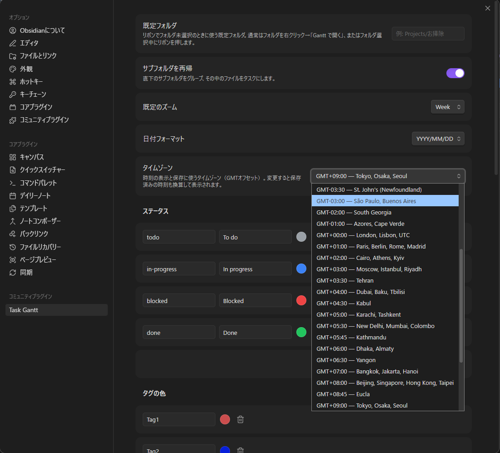

**休日の曜日**（土・日／金・土／日のみ／なし）は、期間の計算と依存による移動のときに数えません。**FS の後続を自動で押し出す**（既定はオン）で、先行の遅れを FS の後続へ伝えるかを切り替えます。

**稲妻線の色**設定で、表示オプションの**稲妻線**で描かれる折れ線の色を変更できます（既定の橙に戻すボタン付き）。

**ステータスは自由に追加・編集・削除**できます（ここでも、ボードの凡例からでも）。各ステータスは **id**（フロントマターの `status` 値と対応）・**ラベル**・**グループ**・**色**（バー色に反映）を持ちます。

**グループ**は「そのタスクが終わっているか」をプラグインが判断する唯一の根拠です。Wrike に倣った 4 種**固定**で、増やすことはできません：**アクティブ**（作業中）・**完了**（終了）・**延期**（保留・ブロック・待ち）・**キャンセル**（中止）。各ステータスはちょうど 1 つに属し、フィルタプリセットの**完了済み／未完了**はグループだけを見ます（ステータス名は見ません）。そのため `リリース済み` という名前でも、完了グループに入れておけば完了として扱われます。完了グループのステータスが 1 つも無い場合は設定画面に注意が出て、**完了済み**プリセットは常に 0 件になります。

> 2.8.x からの更新時：既存のステータスには、id とラベルからグループを一度だけ推測して設定します（`done`／`完了` → 完了、`cancelled`／`中止` → キャンセル、`on hold`／`blocked`／`保留` → 延期、それ以外 → アクティブ）。更新後に一覧を確認し、外れているものは直してください。

プラグインが読む**フロントマターのキー名**（start / end / status / assignee / after / progress / milestone / canvas）も、各自の Vault の慣習に合わせて変更できます。

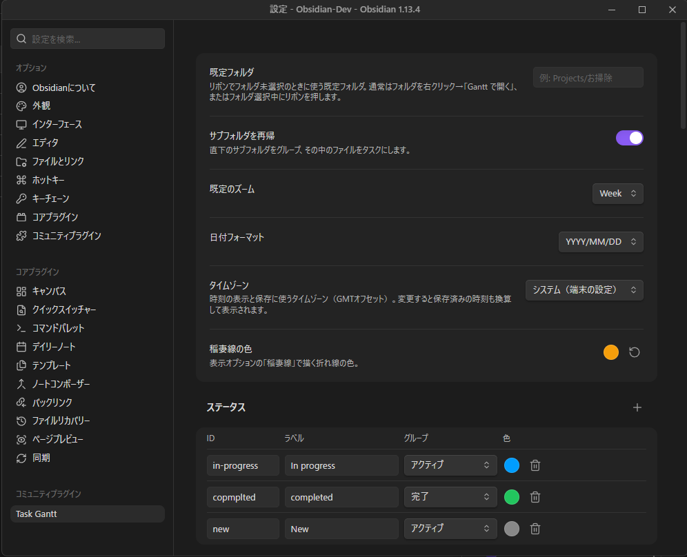

## 通知（任意）

**時刻を設定した**タスクの開始・期限を、Incoming Webhook 経由で **Discord** / **Slack** に通知できます。**設定 → Task Gantt → 通知** で Webhook URL・対象（開始/期限）・通知タイミング（1週間前・1日前・1時間前・10分前・時刻ちょうど）を設定してください。**テスト送信**ボタンで Webhook の疎通をすぐ確認できます。

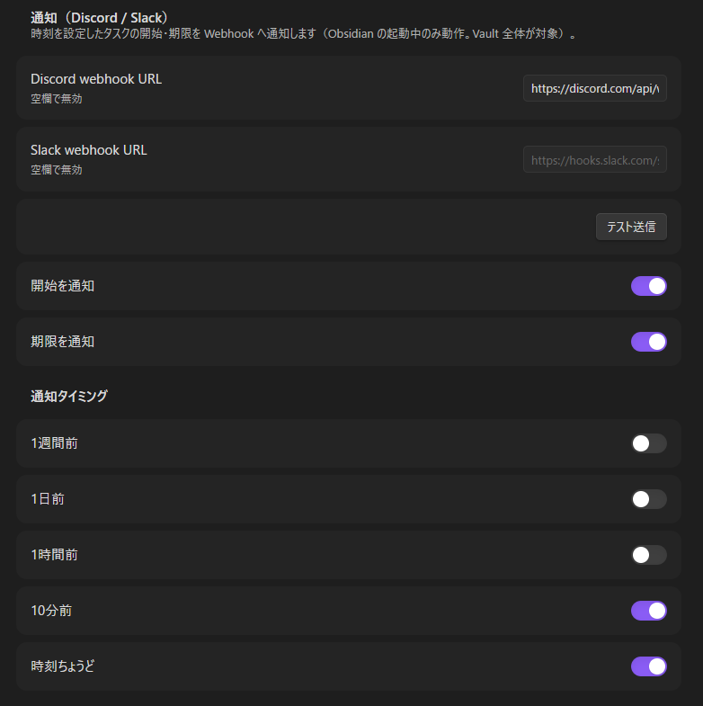


- **ネットワーク利用について**：有効にすると、設定した Webhook URL に対してタスク名と日時のみを HTTP POST で送信します。それ以外の情報は送らず、他の宛先にも送信しません。URL を両方空欄（既定）にすればネットワークアクセスは一切行いません。
- 通知は Obsidian の起動中のみ動作します。終了中に過ぎたタイミングはスキップされ、同じ通知は二度送られません。
- 日付のみ（時刻なし）のタスクは通知対象外です。
- 対象は Vault 全体です。フォルダの設定は不要で、時刻を設定したタスクはすべて対象になります。

## Google カレンダー同期（任意・デスクトップ専用）

タスクと Google カレンダーを**双方向で同期**できます。タスクの作成・日程変更・削除はイベントとして反映され、Google カレンダー側でのイベント移動・削除はタスクのフロントマターへ書き戻されます。**設定 → Task Gantt → Google カレンダー** で方向ごと（Push / Pull）に ON/OFF できます。

### セットアップ

プラグインにはサーバーがないため、**ユーザー自身の Google Cloud プロジェクト**を使います。

1. [Google Cloud Console](https://console.cloud.google.com/) でプロジェクトを作成し、**Google Calendar API** を有効化する。
2. OAuth 同意画面を設定（External で可）し、自分の Google アカウントを**テストユーザー**に追加する。アプリは自分専用の未確認アプリなので、同意時に「確認されていないアプリ」の警告が出ますが想定どおりです（そのまま続行してください）。
3. **OAuth クライアント ID**（種類：**デスクトップアプリ**）を作成し、クライアント ID とシークレットをプラグイン設定に貼り付ける。
4. **接続**を押すとブラウザで Google の同意画面が開き、`127.0.0.1`（ループバック）で認可を受け取ります。その後**同期先カレンダー**を選択してください（専用カレンダーの利用を推奨）。

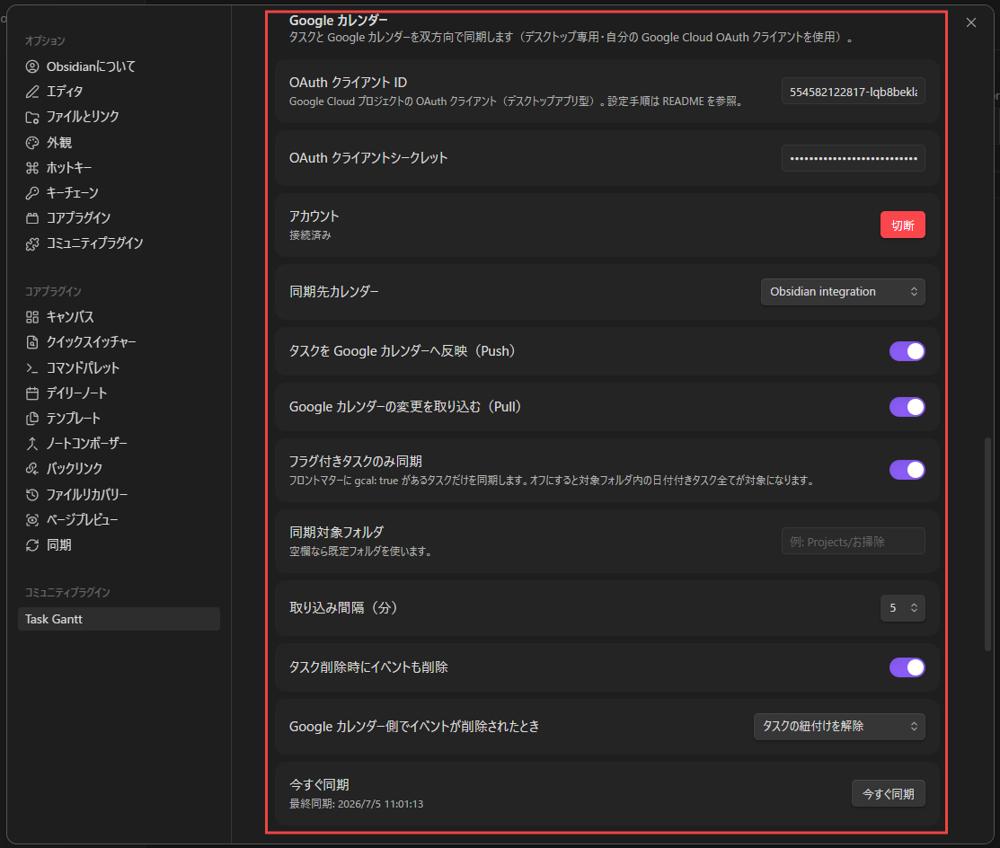

### 同期の仕組み

- **Pull（Google カレンダー→タスク）が対象にするのは、Task Gantt 自身が作成したイベントのみです。** Google カレンダー側で直接イベントを新規作成しても、それがタスクとして取り込まれることは**ありません**。また、プラグインが関与していない既存イベントの編集・削除も無視されます — Pull は自分がPushしたイベントへの変更を読み戻すだけで、カレンダーに元からある予定には一切手を付けません。
- 既定ではフロントマターに **`gcal: true`** フラグを付けたタスクだけが同期されます（**オプトイン**。詳細パネルのトグルで切替でき、同期済みタスクには **Google カレンダーで開く** リンクも表示されます）。**フラグ付きタスクのみ同期**をオフにすると、対象フォルダ内の日付付きタスク全てが対象になります。
- 日付のみのタスクは**終日イベント**、両端に時刻のあるタスクは時刻付きイベント（プラグインの**タイムゾーン**設定を使用）、マイルストーンは1日のイベントになります。紐付け先イベントの ID はタスクの `gcalId` キーに自動で保存されます（手動編集は不可）。
- ローカルの編集は数秒で Push され、Google カレンダー側の変更は設定間隔（既定5分）で Pull されます。タイトルの同期はタスク→イベントの一方向のみで、イベント名を Google カレンダー側で変更しても次の Push でタスク名に戻ります（外部からのファイルリネームは危険なため）。
- 前回同期以降に両側が変更されていた場合は**新しい方の編集が勝ち**、どちらを採用したかを通知します。
- タスクを削除するとイベントも削除されます（設定で変更可）。Google カレンダー側でイベントを削除した場合、既定ではタスクの**紐付けを解除するだけ**です（日付もクリアする設定あり）。ファイルが削除されることはありません。
- 繰り返しイベントは Push / Pull とも対象外です。

**例**：`Test1` と `Test2` は `gcal: true` を付けて Push され、イベントとして反映されています。`Test3 (no flag)` はフラグが無いためローカルのみに留まっています。一方 `Test3 from GC` と祝日「七夕」は Google カレンダー側で直接作られたもので、タスクとしては取り込まれていません：


### 開示事項

- **ネットワーク利用について**：接続すると Google の OAuth / Calendar API とのみ通信し、同期対象タスクの名前・日付・本文抜粋（先頭500文字）とノートへ戻るリンクを送信します。未設定（既定）の場合、ネットワークアクセスは一切行いません。
- **アカウントと認証情報**：Google アカウントと自身の Google Cloud OAuth クライアントが必要です。要求スコープは `calendar.events` と `calendar.calendarlist.readonly` のみです。OAuth の**クライアントシークレットとリフレッシュトークンは Obsidian のシークレットストレージ（OS のキーチェーン）に保存**され、プラグインの `data.json` には書き込まれません。そのため Vault の同期・バックアップ・git には含まれません。`data.json` に残るのはクライアント ID のみです。シークレットストレージは端末ごとの保存なので、端末ごとに接続し直してください。2.9.3 以前から更新すると、`data.json` に平文で残っていた値は自動で移行・削除されます。過去に `data.json` を git へコミット・共有したことがある場合は、Google Cloud Console でクライアントシークレットを再発行し、接続し直してください。
- モバイルは非対応です（OAuth のループバック受信にデスクトップが必要）。他の機能は従来どおりモバイルでも動作します。

## Vault へのアクセス

ボードを組み立てるため、プラグインは Vault 内の Markdown ファイルを一覧し、Obsidian のメタデータキャッシュを通してフロントマターを読み取ります。フォルダを開いたときに表示されるのはそのフォルダ配下のノートだけです。ただし、通知は Vault 全体を対象にし、カスタムフィールドのキー名を変えるときは全ノートからそのキーを探します。読み取った内容が端末の外へ出ることはありません。ネットワークを使うのは、上に書いた任意の通知と Google カレンダー同期だけです。

## 開発

```bash
npm install      # 依存をインストール
npm run dev      # 監視ビルド
npm run build    # 型チェック＋本番ビルド
npm test         # ヘッドレスのモデルテスト
```

`main.js` / `manifest.json` / `styles.css` を `<vault>/.obsidian/plugins/task-gantt/` にコピーして有効化。

## 設計

設計判断の経緯は [`docs/adr/`](./docs/adr/)（最新は ADR-0005）、用語は [`CONTEXT.md`](./CONTEXT.md) を参照。

## 既知の制限

自動スケジューリング（クリティカルパス）・時刻粒度・複数フォルダ横断は未実装。カスタムフィールドはまだフィルタに使えません。

## ライセンス

MIT ライセンス（[`LICENSE`](./LICENSE) を参照）。
